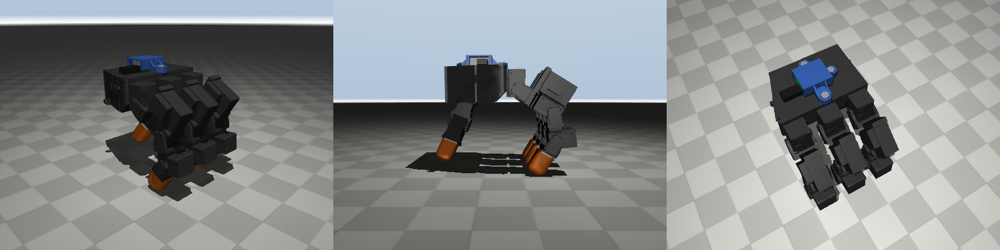
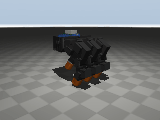

# Walking LEAP

Reinforcement learning for **finger walking with the LEAP Hand V1**: a 16-DOF
anthropomorphic hand, turned palm-down, that should learn to walk on its
fingers. The long-term goal is emergent locomotion, directional control,
robustness and sim-to-real deployment on the physical hand.


*Nominal pose after settling, three views (3/4, side, front). Axes show the palm
(base) frame: red +x = forward (wrist → fingertips), green +y = thumb side,
blue +z = back of the hand. Orange dots are the four ground contacts.*

## Status

**New here, or picking this branch up: [docs/handoff.md](docs/handoff.md)** (what the branch adds, how to run it, what to train next, the hardware).

**Foundation, and first policies in simulation.** The robot, the physics and the mjlab
tasks are in place and tested. One animation is learned and one baseline walks, one
training seed each, in simulation only ("First runs"); walking with the as-built hand
is not solved. **On the real hand** (scripts only, no policy driving yet): it stands up
on its own, does push-ups, lifts one finger at a time and crawls forward 12+ cm in
six scripted cycles; the simulator's gravity direction matches the real IMU's within
about 1.6° on average. See [docs/real_hand.md](docs/real_hand.md) and [PLAN.md](PLAN.md).
What the next training batch should change, from all of it:
[docs/next_training.md](docs/next_training.md).

| Zero action: drops ≤ 5 mm and stands | Joint sweep (gravity off): each digit in turn | Random actions: untrained behavior |
| :---: | :---: | :---: |
|  |  |  |

All media but the real hand's (`docs/media/real_*.png`, `standup_sim.png`: from logs) are rendered by [`docs/render_media.py`](docs/render_media.py) with
the same model, physics options and action mapping as the environment.

## Technical stack

| Component | Version | Role |
| --- | --- | --- |
| [mjlab](https://github.com/mujocolab/mjlab) | 1.6.1 (pinned) | Managers, task registry, `train`/`play` CLIs, viewers |
| MuJoCo / MuJoCo Warp | 3.11.0 | Physics (CPU) / batched GPU physics |
| [RSL-RL](https://github.com/leggedrobotics/rsl_rl) | 5.4.2 (via mjlab) | PPO |
| PyTorch | 2.15 (via mjlab) | Networks |
| [uv](https://docs.astral.sh/uv/) | tested 0.12.7 | Environment and lock file |

## Repository layout

```
src/walking_leap/
  __init__.py      Registers the tasks (loaded via the mjlab.tasks entry point)
  robot.py         MJCF loading, floating base, actuators, collisions, poses, add-on parts
  env_cfg.py       Walking: scene, sim, observations, actions, command, rewards, terminations
  motion_cfg.py    Motion imitation: the same for playing a reference animation
  clips.py         The animations, written as keyframes and solved with planted feet
  agent_cfg.py     PPO runner / network configuration
  mdp.py           The few MDP terms mjlab does not provide
  assets/leap_hand/  Unmodified MuJoCo Menagerie right_hand.xml + meshes (MIT)
  assets/parts/    Feet, IMU cover and pad (see "As-built hand"; licences inside)
  assets/clips/    Solved animations, written by clips.py
tests/
  test_robot.py    Model structure and physics (plain MuJoCo, CPU)
  test_as_built.py The same for the hand with its parts
  test_env.py      mjlab walking environment (GPU if available, else CPU)
  test_motion.py   Animations and the motion-imitation environment
docs/
  render_media.py  Renders the README images/GIFs into docs/media/
  real_hand.md     The first runs on the real hand: what ran, sim against real
  handoff.md       Start here: what this branch adds, how to run it, what to train next
  next_training.md What the next training batch should change, and why
  data/real_clips/ The joint targets the real hand played (50 Hz, with the sim's IMU reading)
hardware/          The printed parts, latest versions: IMU mount, foot socks (STL, STEP, licences)
PLAN.md            Roadmap and verified progress
AGENTS.md          Conventions for contributors and coding agents
```

## Installation

Requirements: Linux x86-64; an NVIDIA GPU with a recent driver for training
(tested: RTX 5060 Laptop 8 GB, driver 595, CUDA 13.2). Viewing, tests and
smoke runs also work on the CPU, only slower.

```sh
git clone git@github.com:BrikHMP18/walking-leap.git && cd walking-leap
uv sync
uv run list-envs        # Walking-Leap-Flat-v0 must be listed
```

| Task | Hand | What |
| --- | --- | --- |
| `Walking-Leap-Flat-v0` | stock | walk forward |
| `Walking-Leap-Motion-Flat-v0` | as built, 350 mA | play an animation |
| `Walking-Leap-Motion-Flat-v1` | as built, 350 mA | the same, with kicks, cables, noise, delay and random numbers |

## Usage

Visualize the environment without a policy (`--viewer native` opens a MuJoCo
window; `--viewer viser` serves a web viewer at http://localhost:8080):

```sh
uv run play Walking-Leap-Flat-v0 --agent zero    # hold the nominal pose
uv run play Walking-Leap-Flat-v0 --agent random  # uniform random actions
```

Training smoke test (seconds; checks rollouts, PPO updates and checkpoints):

```sh
uv run train Walking-Leap-Flat-v0 --env.scene.num-envs 512 --agent.max-iterations 10
```

Full training is **not** part of the foundation. When phase 5 starts, the entry
point is the same CLI:

```sh
uv run train Walking-Leap-Flat-v0 --env.scene.num-envs 4096
```

Runs are written to `logs/rsl_rl/walking_leap_flat/<date_time>/` (TensorBoard
logs, `params/env.yaml`, `params/agent.yaml`, `model_<iteration>.pt`). Add
`--agent.logger wandb` to log to Weights & Biases instead. Play a checkpoint:

```sh
uv run play Walking-Leap-Flat-v0 \
  --checkpoint-file logs/rsl_rl/walking_leap_flat/<date_time>/model_<iteration>.pt
```

Any config field can be overridden from the CLI (`--env.<field>`,
`--agent.<field>`); see `uv run train Walking-Leap-Flat-v0 --help`.

Animations (see "Animations"):

```sh
uv run python -m walking_leap.clips      # rebuild assets/clips/*.npz after an edit
uv run train Walking-Leap-Motion-Flat-v1 --env.scene.num-envs 4096
uv run play Walking-Leap-Motion-Flat-v1 \
  --motion-file src/walking_leap/assets/clips/hello.npz \
  --checkpoint-file logs/rsl_rl/walking_leap_motion/<date_time>/model_<iteration>.pt
```

## Tests

```sh
uv run pytest                              # 41 tests: 23 robot/physics, 18 clips and environments
CUDA_VISIBLE_DEVICES="" uv run pytest      # CPU only (~45 s)
uv run ruff check src tests docs && uv run ruff format --check src tests docs
uv run python docs/render_media.py         # regenerate docs/media/
```

## Design

### Robot (`robot.py`)

The Menagerie MJCF (commit `71f066a`) is kept byte-identical (a test checks its
sha256). Changes are applied in code: a free joint on `palm`; the XML position
actuators (kp = 3, no torque limit) replaced by mjlab actuators; collision
priority so the hand's contact parameters govern ground contact; the palm placed
palm-down in `qpos0`; the XML `<option>` reset (physics options live in
`env_cfg.py`). Masses, inertias, geometry, joint names and limits are untouched
(total mass 0.746 kg).

**Actuators.** Each joint has MuJoCo's native DC-motor model in position mode
(`BuiltinDcMotorActuatorCfg`), parameterized by the Dynamixel XC330-M288-T
datasheet, so the torque–speed limit is physical:

| Parameter | Value | Source |
| --- | --- | --- |
| Supply voltage, stall torque, no-load speed | 5 V, 0.93 N·m, 81 rpm (8.48 rad/s) | Datasheet (ROBOTIS e-manual) |
| Small-signal stiffness | 3.0 N·m/rad | LEAP authors' simulator (`LEAP_Hand_Sim`), Menagerie |
| Damping | back-EMF only, 0.11 N·m·s/rad | Derived from datasheet (≈ LEAP_Hand_Sim's 0.1) |
| Torque limit | 0.5 N·m | LEAP_Hand_Sim; true value set by the servo current limit, **not measured** |
| Armature | 0.001 kg·m² | LEAP_Hand_Sim |
| Joint passive damping / frictionloss | 0 / 0.001 | Datasheet curve already includes gearbox losses / Menagerie |

A plain PD with the same torque cap let joints reach 13–16 rad/s; the DC model
caps them at the 8.48 rad/s no-load speed (tested).

**Nominal pose.** Palm down and level; index, middle and ring flexed under the
front of the palm (mcp 0.9, pip 0.6, dip 0.3 rad, no abduction); thumb swung
down behind (cmc 1.75, axl 0, mcp −0.15, ipl −0.7 rad). The hand stands on four
digit tips: three in front (palm-frame x = +0.017 m) and the thumb behind
(x = −0.129 m). The digits are not treated as symmetric legs. The pose came from
a kinematic search maximizing the CoM's margin inside the support polygon
(29 mm) with every joint ≥ 0.25 rad from its limits. In simulation it stands
with 0.04 N·m peak joint torque, 110 mm palm clearance, 0.5° tilt and < 1 mm
drift over 4 s. It is a tall stance; whether it suits walking is open (phase 5).

**Contacts.** Every box/mesh collision primitive of the palm and digits can
touch the ground and the other digits (Menagerie's contact exclusions, palm vs.
proximal links and between finger bases, are kept). Friction comes from the model: 0.5 on fingertips, 0.2 elsewhere
(not measured).

### As-built hand (`robot.py`, `as_built=True`)

What goes on the real hand on top of the stock one, as child bodies without joints.
**Nothing here is measured yet**: the numbers are CAD, datasheets and assumptions, and
`robot.py` says which is which.

| Part | In the model | Source |
| --- | --- | --- |
| Feet: a thin TPU 95A sock on each fingertip (designed, not printed yet) | one 64-point convex mesh each, 4.8 g, 2.2 mm longer than the tip, friction 0.6 (expect 0.4 to 0.9), soft contact | CAD; friction and softness assumed |
| IMU: SYD TransducerM TM171 on a thin pad, under a cover on three M6 bolts of the back lid (printed, not weighed) | 58 g with its USB plug, centre at (-56, -35, 18) mm from the palm origin, one contact box without the bosses and the plug, site `imu`, sensors `imu_ang_vel` and `imu_upvector` in the IMU's own axes | datasheet and CAD; bolts and plug assumed |
| Cables: the IMU's USB, the hand's USB and power | not modelled as bodies; `Walking-Leap-Motion-Flat-v1` pulls on the IMU mount and the palm with a random steady force (up to 0.15 N an axis each) and torque (0.01 N·m), changed every 1 to 4 s | guessed |
| Thumb limits | `th_axl` -0.47..2.443, `th_mcp` -1.20..1.90 rad | LEAP authors' URDF and API; Menagerie's file has them shifted by one joint |
| Torque cap | 0.181 N·m: 350 mA, the API's default, on the datasheet's stall point | estimated |



*As-built hand in the folded-thumb stance: orange feet, the IMU under its blue cover,
its USB plug (black) on the ring side.*

The IMU is turned a quarter left on its mount: palm x = −IMU y, palm y = IMU x,
palm z = IMU z (`test_imu_axes`). The hand weighs 0.823 kg with its parts.

**Folded-thumb stance.** With the limits above the thumb can also stand folded under
the palm the other way round. On planted feet the palm then moves −60/+27 mm in height
and ±41° in yaw (−18/+6 mm, −17/+34° in the nominal pose), for the same joint torque
(about 0.06 N·m at the hardest joint). The as-built tasks start from it.

### Animations (`clips.py`, `motion_cfg.py`)

A clip is a path of the palm plus finger gestures, written by hand. Feet that are not
lifted stay planted: their joints are solved frame by frame. `hello` (22.4 s): two
push-ups, a stretch, hip circles, look left and right, wave with the index, drum the
fingers, bow. `clips.report` gives its margins: 7.8 mm of balance at worst, 0.1 rad from
a joint limit, 4.5 rad/s at the fastest joint.



*`hello` as position targets in physics, without a policy.*

Imitation uses mjlab's motion-tracking terms (BeyondMimic) at this hand's scale. The
actor sees the clip's joints and tilt, the encoders, the IMU's rate and gravity, and
its last action (89 numbers): never its position or heading.

### Environment (`env_cfg.py`)

| | |
| --- | --- |
| Physics | 0.002 s step (500 Hz), implicitfast, elliptic cones, impratio 1, Newton 100 / 50 line-search iterations |
| Control | decimation 10 → 50 Hz policy |
| Episode | 10 s, flat plane, reset to the nominal pose with random yaw and a 0–5 mm drop |
| Command | constant `vx = 0.05 m/s`, `vy = wz = 0`, palm frame |
| Actions (16) | `target = nominal + 0.25 · action`, clipped to joint limits |

Frames: world z up; palm frame +x forward, +y thumb side, +z dorsal. Palm-down
standing is the identity orientation, so mjlab's body-frame quantities need no
extra rotation.

Observations (no noise or delay yet):

| Group | Terms | Dim | Real-robot source |
| --- | --- | --- | --- |
| actor | palm angular velocity (body) | 3 | **IMU required** (not on the stock hand) |
| actor | projected gravity (body) | 3 | **IMU required** (attitude estimate) |
| actor | joint position − nominal, joint velocity | 16 + 16 | Dynamixel encoders |
| actor | previous action, velocity command | 16 + 3 | Policy state |
| critic | actor terms + palm linear velocity, palm height, per-digit ground contact and force, palm contact | 78 | Simulator only (privileged) |

Rewards (rates per second, multiplied by the 0.02 s step):

| Term | Weight | Definition |
| --- | --- | --- |
| `track_lin_vel` | 2.0 | exp(−(‖v_cmd,xy − v_xy‖² + v_z²) / 0.05²) |
| `track_ang_vel` | 0.5 | exp(−(ω_z² + ‖ω_xy‖²) / 0.5²) (zero yaw command) |
| `palm_height` | 1.0 | exp(−(max(0.08 − h, 0) / 0.02)²), one-sided |
| `upright` | 1.0 | exp(−‖g_xy‖² / 0.2) |
| `joint_torques` | −0.2 | Σ τ² |
| `action_rate` | −0.05 | Σ (a_t − a_{t−1})² |
| `palm_contact` | −2.0 | 1 if the palm touches the ground |

No gait timing, contact sequence, reference motion or symmetry term. The weights
are initial values and have not been tuned by training.

Terminations: time limit (truncation, not failure), non-finite state, palm tilt
> 70°, palm on the ground continuously > 1 s. Metrics logged separately from the
reward (`Episode_Metrics/*`): forward velocity, net displacement, palm contact
fraction, actuator saturation fraction, mechanical power (mechanical output, not
electrical consumption), plus mjlab's velocity-tracking errors.

### First runs

One seed (42) each, 4,096 environments, default PPO. Metrics are independent of the
reward, over one 10 s rollout (walking) or 128 rollouts of the whole clip (animation).

**Walking**, 0.05 m/s commanded. Torque above 0.181 N·m is what 350 mA could not give.

| Run | Result |
| --- | --- |
| `Walking-Leap-Flat-v0`, 3,000 iterations (`logs/rsl_rl/walking_leap_flat/2026-11-24_20-38-51_baseline_v0`) | walks 0.50 m in 10 s without falling, tilt under 1.2°, heading off by 15°; a small-step shuffle at 2 Hz, the thumb tapping 6 times a second; 0.9 % of joint-steps above 0.181 N·m, peak 0.39 |
| As built, base rewards, stopped at 420 | 0.48 m, but on three fingers: the thumb never touches the ground, motors at their cap 16 % of the time. The base rewards do not stop it |
| As built, first gait terms, stopped at 1,800 | a reward for time in the air was met by balancing on the middle finger and the thumb, 0.45 m. Term removed |
| As built, second gait terms (at most one foot up), stopped at 430 | the index held up for good (2 % contact), 0.42 m in 10 s |
| As built, third gait terms, 3,000 iterations (`logs/rsl_rl/walking_leap_flat/2026-11-24_22-03-48_as_built_crawl`) | slow real steps (0.67 Hz) on three digits, 0.027 m/s, 0.26 m in 10 s, turning 56° on the way; the index stays up 95 % of the time; motors at their cap 2.3 % of joint-steps |

The as-built walking tasks of these runs (`Flat-v1` and `-v2` with gait terms) were tests and are
no longer in the repository: their results stay here. The next try imitates the scripted
crawl instead (docs/next_training.md). The walking runs had an earlier IMU holder (47 g instead of 58). The cover gained room
for the board's pins after the animation runs: its masses in the model are the same, its
contact box is 0.9 mm longer. The "randomized, cables" policy replayed on it stays within
1 point of its column below.

**Animation** `hello`: "nominal" (`Walking-Leap-Motion-Flat-v0`, 2,000 iterations,
`logs/rsl_rl/walking_leap_motion/2026-11-25_01-19-49_v3_nominal`), "randomized, cables"
(`-v1`, 3,000, `2026-11-25_00-41-24_v3_cables`) and the same without the cables' pull
("randomized", 3,000, `2026-11-25_00-41-26_v3_nocables`), against playing the clip's
joints as targets without a policy. Finished means upright to the end of the clip; the
distance is the mean error of the tracked links, root-relative.

| Change | Clip as targets | Nominal | Randomized | Randomized, cables |
| --- | --- | --- | --- | --- |
| as designed | 100 % (2.0 mm) | 100 % (2.3 mm) | 100 % (1.5 mm) | 100 % (1.8 mm) |
| softer motors (2.0 N·m/rad instead of 3.0) | 96 % (3.2 mm) | 100 % (2.6 mm) | 100 % (1.8 mm) | 100 % (2.0 mm) |
| much softer motors (1.4 N·m/rad) | 13 % (5.1 mm) | 100 % (3.4 mm) | 100 % (2.7 mm) | 100 % (2.7 mm) |
| weaker motors (0.13 N·m) | 100 % (17.0 mm) | 100 % (2.8 mm) | 100 % (1.5 mm) | 100 % (1.8 mm) |
| commands 40 ms late | 95 % (4.3 mm) | 98 % (3.7 mm) | 98 % (2.7 mm) | 98 % (3.2 mm) |
| friction 0.4 | 100 % (2.0 mm) | 100 % (2.4 mm) | 100 % (1.5 mm) | 100 % (1.8 mm) |
| friction 0.3 | 100 % (2.0 mm) | 100 % (2.4 mm) | 100 % (1.6 mm) | 100 % (1.8 mm) |
| 60 g more on the back | 0 % (3.0 mm) | 100 % (2.3 mm) | 100 % (1.5 mm) | 100 % (1.8 mm) |
| encoders off by up to 0.03 rad | 65 % (3.0 mm) | 98 % (3.1 mm) | 100 % (2.3 mm) | 100 % (2.5 mm) |
| kicked every 2 s, up to 0.10 m/s | 87 % (2.1 mm) | 98 % (2.3 mm) | 100 % (1.6 mm) | 100 % (1.9 mm) |
| kicked, up to 0.20 m/s | 53 % (2.4 mm) | 72 % (2.6 mm) | 75 % (1.9 mm) | 76 % (2.2 mm) |
| kicked, up to 0.30 m/s | 30 % (3.0 mm) | 38 % (3.2 mm) | 46 % (2.3 mm) | 48 % (2.7 mm) |
| cables pulling as guessed (As-built hand) | 66 % (2.3 mm) | 99 % (2.4 mm) | 100 % (1.6 mm) | 100 % (1.9 mm) |
| cables pulling twice that | 32 % (3.1 mm) | 72 % (2.8 mm) | 90 % (1.8 mm) | 97 % (2.0 mm) |
| cables pulling three times that | 15 % (4.1 mm) | 37 % (3.8 mm) | 55 % (2.3 mm) | 74 % (2.3 mm) |
| a bit of everything: 2.0 N·m/rad, 0.15 N·m, 30 ms late, friction 0.5, 30 g more, encoders 0.02 rad, kicks 0.10 m/s | 36 % (13.2 mm) | 77 % (4.6 mm) | 98 % (2.9 mm) | 100 % (2.9 mm) |
| the same, and the cables | 27 % (10.1 mm) | 49 % (5.7 mm) | 88 % (3.1 mm) | 95 % (3.0 mm) |

A steady force at the IMU's USB plug, for the whole clip: the largest pull (N) that all 32
hands of a direction finished (0.1, 0.2, 0.3, 0.4, 0.6, 0.8, 1.2 N tried; 0 means 0.1 N
was already too much). The cable leaves on the ring side.

| Pull towards | Clip as targets | Nominal | Randomized | Randomized, cables |
| --- | --- | --- | --- | --- |
| fingers | 0.8 | 0.6 | 0.8 | 1.2 |
| wrist | 0 | 0.3 | 0.4 | 0.8 |
| thumb side | 0.4 | 0.6 | 0.8 | 0.8 |
| ring side | 0 | 0.3 | 0.4 | 0.6 |
| down | 0.1 | 0.4 | 0.8 | 1.2 |

With 128 rollouts a cell is good to about 3 points near 100 % and 9 near 50 %. Friction
reaches the simulator (checked by reading it back): the clip is slow and its feet stand
nearly straight, so it needs little of it. Most falls are in the wave, on three feet; with
late commands they come in the first second, for all four. The randomized policies were
trained on ranges that include most of the last rows' values, and all of this is the
simulator the policies learned in. An earlier nominal run, same seed, on the 47 g holder
ended with 1.5 mm of link error instead of 2.3: one seed says little about small gaps.

### PPO (`agent_cfg.py`)

RSL-RL PPO through mjlab's runner: separate actor and critic MLPs
(256-128-64, ELU, empirical observation normalization), Gaussian policy with
initial std 1.0, mjlab's default hyperparameters (lr 1e-3 adaptive,
γ 0.99, λ 0.95, clip 0.2, entropy 0.005, 5 epochs × 4 mini-batches, 24 steps
per env), seed 42, TensorBoard logging.

### Simulation-specific decisions

- `impratio` is 1, not the Menagerie's 100: with 100, MuJoCo Warp 3.11 contact
  sensors returned NaN forces in about 1 in 10⁶ env-steps (physics stayed finite).
- Solver iterations stay at mjlab's defaults (100 / 50). With mjlab's quadruped
  setting (10 / 20), elliptic cones do not converge and the standing hand creeps
  32 mm in 4 s.
- Contact buffers are set explicitly (`nconmax=64`, `njmax=256` per world);
  automatic sizing ran out of memory at 4096 envs on 8 GB.
- Elliptic cones cost throughput: ~51k vs. ~85k env-steps/s for pyramidal
  (4096 envs, RTX 5060 Laptop).
- `mdp.VelocityCommand` is mjlab's velocity command without its Viser joystick,
  whose sliders start at 0.1 and crash the viewer for this 0.05 m/s command.

## Known limitations

- The policies of "First runs" are one seed each and have only met this simulator
  (the animation policy has run on the real hand in the shadow only: computing, not
  driving).
- Walking with the as-built hand is not solved: see "First runs".
- Actuator torque limit, stiffness and armature come from the LEAP authors'
  simulator, not from measurements on hardware (the real joints track like a
  2.2-3.0 N·m/rad servo at gains 1200 / 0 / 600: docs/real_hand.md); friction coefficients come from
  the Menagerie model.
- The actor uses angular velocity and gravity direction that would need an IMU
  on the palm; its mass is modelled in the as-built hand, its noise and latency only
  in the randomized animation task (`-Motion-Flat-v1`).
- The walking tasks have no observation noise, actuation delay or domain
  randomization (nominal physics first, by design).
- Contacts have no torsional friction (`condim=3`): a fingertip spins on the floor
  for free, and the simulated hand turns the other way from the real one while
  crawling (docs/next_training.md).
- Joint conventions differ from the LEAP hardware API: the API orders each finger
  (side, forward, pip, dip) while the MJCF orders (mcp, rot, pip, dip), and the
  API's thumb limits (`LEAPsim_limits`) differ from the Menagerie ones. Both must
  be reconciled before deployment.
- The hand's real mass is not verified (no official figure found); the model
  has 0.746 kg.
- The as-built hand's feet are designed, not printed; the IMU holder is printed, not
  weighed. Weights and grip are CAD and assumptions. The folded-thumb stance works on the real hand (docs/real_hand.md).
- Static support is verified in simulation only, for one nominal pose.

## References and acknowledgments

- mjlab — https://github.com/mujocolab/mjlab, docs https://mujocolab.github.io/mjlab/;
  structure follows the external-robot example https://github.com/mujocolab/anymal_c_velocity
- MuJoCo Menagerie LEAP Hand model (MIT) —
  https://github.com/google-deepmind/mujoco_menagerie/tree/main/leap_hand
- LEAP Hand — https://v1.leaphand.com/; K. Shaw, A. Agarwal, D. Pathak,
  "LEAP Hand: Low-Cost, Efficient, and Anthropomorphic Hand for Robot Learning",
  RSS 2023
- LEAP Hand API — https://github.com/leap-hand/LEAP_Hand_API; LEAP Hand simulator
  (actuator values) — https://github.com/leap-hand/LEAP_Hand_Sim
- ROBOTIS XC330-M288-T e-manual — https://emanual.robotis.com/docs/en/dxl/x/xc330-m288/
- MuJoCo, MuJoCo Warp, RSL-RL, PyTorch

## License

MIT (see [LICENSE](LICENSE)). The LEAP Hand model keeps its own MIT license in
`src/walking_leap/assets/leap_hand/LICENSE`. The foot socks' meshes are adapted from
LEAP Hand CAD and are CC BY-SA 4.0 (`src/walking_leap/assets/parts/LICENSE`).
