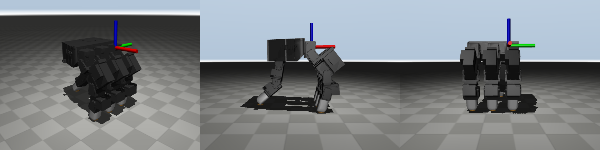
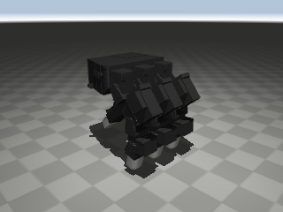

# Walking LEAP

Reinforcement learning for **finger walking with the LEAP Hand V1**: a 16-DOF
anthropomorphic hand, turned palm-down, that should learn to walk on its
fingers. The long-term goal is emergent locomotion, directional control,
robustness and sim-to-real deployment on the physical hand.



*Nominal pose after settling, three views (3/4, side, front). Axes show the palm
(base) frame: red +x = forward (wrist → fingertips), green +y = thumb side,
blue +z = back of the hand. Orange dots are the four ground contacts.*

## Status

**New here: [docs/handoff.md](docs/handoff.md)** (the as-built hand, the animations,
the real hand and what to train next).

**Foundation, first policies in simulation, scripted runs on the real hand.**

- **Walking, nominal model** (`Walking-Leap-Flat-v0`, constant 0.05 m/s forward):
  trained on Rorqual (Slurm job 27623314, 3000 PPO iterations, 4096 envs). Seeds 42
  and 43 move at 0.049 m/s (0.49–0.50 m per 10 s episode), never fall and never
  touch the palm; seed 44 stopped at iteration 2700 on the job's time limit. The
  gait is a tripod (index, ring, thumb) with the middle finger lifted most of the
  time (ground contact 9–19 %), and the fingertips slide at 1.3–1.9 cm/s while in
  contact: the hand partly steps and partly drags. Numbers: last-iteration
  `Episode_Metrics` of runs `2026-11-25_11-43-22` (seed 42) and
  `2026-11-25_11-41-44` (seed 43). An earlier single run is in "First runs".
- **Walking with the as-built hand** is not solved by rewards alone ("First runs").
- **Animation:** one clip (`hello`) is learned by imitation, one seed ("First runs").
- **On the real hand** (scripts only, no policy driving yet): it stands up on its
  own, does push-ups, lifts one finger at a time and crawls forward 12+ cm in six
  scripted cycles; the simulator's gravity direction matches the real IMU's within
  about 1.6° on average ([docs/real_hand.md](docs/real_hand.md)).
- **Imitating the real crawl** on the real hand's model (IMU, stock tips, 350 mA,
  measured stiffness, torsional friction), nominal, with and without the IMU in the
  actor (`Walking-Leap-Motion-Crawl-Flat-v0`, `-NoImu-v0`): trained on Rorqual
  (Slurm jobs 27676904 and 27676905, 3000 PPO iterations, seeds 42 and 43 each). In
  the training logs (mean of the last 100 iterations) all four runs keep the palm
  5.8–6.3 mm and 3.0–3.3° from the clip, episodes last 498.7–500 of 500 steps and
  the palm never touches the ground. Not yet evaluated outside training, randomized
  or run on the real hand; checkpoints and ONNX files in "Checkpoints".
- **Implemented, not yet trained:** omnidirectional commands with a
  fingertip-sliding penalty (`Walking-Leap-Flat-v1`, `-NoImu-v1`) on the nominal
  model, and walking from rewards only on the real hand's model, with and without
  the IMU (`Walking-Leap-Flat-v3`, `-NoImu-v3`; queued on Rorqual, jobs 27680032
  and 27680033). `Walking-Leap-Motion-Gait-Flat-v1` adds randomization, pushes and
  falls that do not end the episode to the scripted crawl below (the clip waits and
  resumes where the hand gets up); smoke-tested only.
- **Imitating a steerable scripted crawl** with the IMU
  (`Walking-Leap-Motion-Gait-Flat-v0`): one cycle per command from the planner in
  `gait.py`; each command's clip and a mixed one stayed up on 45 of 45 random
  simulated hands (`scripts/gait_clips.py`). Trained on Modal (one seed, 3000
  iterations, W&B `pmh0h1vl`); in the training log (iterations 2958-2999) the palm
  stays 8.5 mm and 4.1° from the clip, episodes last 499.4 of 500 steps, no falls.
  Not yet evaluated outside training; it follows the clip's commands, not the
  keyboard yet.

What the next training batch should change, from all of it:
[docs/next_training.md](docs/next_training.md). See [PLAN.md](PLAN.md).

| Zero action: drops ≤ 5 mm and stands | Joint sweep (gravity off): each digit in turn | Random actions: untrained behavior |
| :---: | :---: | :---: |
|  |  |  |

All media but the real hand's (`docs/media/real_*.png`, `standup_sim.png`: from logs) are rendered by [`scripts/render_media.py`](scripts/render_media.py) with
the same model, physics options and action mapping as the environment.

## Technical stack

| Component | Version | Role |
| --- | --- | --- |
| [mjlab](https://github.com/mujocolab/mjlab) | 1.6.1 (pinned) | Managers, task registry, `train`/`play` CLIs, viewers |
| MuJoCo / MuJoCo Warp | 3.11.0 | Physics (CPU) / batched GPU physics |
| [RSL-RL](https://github.com/leggedrobotics/rsl_rl) | 5.4.2 (via mjlab) | PPO |
| PyTorch | 2.15 (via mjlab) | Networks |
| [uv](https://docs.astral.sh/uv/) | tested 0.12.7 | Environment and lock file |
| [Weights & Biases](https://wandb.ai) | 0.28.2 (capped < 0.29, see AGENTS.md) | Optional logger; used by cluster jobs |

## Repository layout

```
src/walking_leap/
  __init__.py      Registers the tasks (loaded via the mjlab.tasks entry point)
  robot.py         MJCF loading, floating base, actuators, collisions, poses, add-on parts
  env_cfg.py       Walking: scene, sim, observations, actions, command, rewards, terminations
  motion_cfg.py    Motion imitation: the same for playing a reference animation
  clips.py         The animations, written as keyframes and solved with planted feet
  agent_cfg.py     PPO runner / network configuration; the teacher-student distillation's
  runner.py        Distillation runner for mjlab's train/play (mjlab 1.6.1 has PPO only)
  mdp.py           The few MDP terms mjlab does not provide
  gait.py          The scripted four-digit crawl: servo targets, one cycle per command
  assets/leap_hand/  Unmodified MuJoCo Menagerie right_hand.xml + meshes (MIT)
  assets/parts/    Feet, IMU cover and pad (see "As-built hand"; licences inside)
  assets/clips/    Solved animations, written by clips.py
cluster/
  env.sh           uv locations on Alliance Canada clusters (sourced by jobs)
  train.sbatch     Slurm job: one training run (one per array task)
  modal_train.py   The same run on a Modal H100 (W&B online, checkpoints to Hugging Face)
tests/
  test_robot.py    Model structure and physics (plain MuJoCo, CPU)
  test_as_built.py The same for the hand with its parts
  test_env.py      mjlab walking environment (GPU if available, else CPU)
  test_motion.py   Animations and the motion-imitation environment
  test_real_runs.py The real hand's recordings, and the simulator replaying one against them
  test_real_loop.py The real hand's loop: clips, policy inputs in the task's order
  test_tm171.py    The IMU's reader, without the IMU
docs/
  real_hand.md     The first runs on the real hand: what ran, sim against real
  handoff.md       Start here: what this branch adds, how to run it, what to train next
  next_training.md What the next training batch should change, and why
  rl_notes.md      Notes: the networks' inputs and outputs, PPO and its alternatives
  data/real_clips/ The joint targets the real hand played (50 Hz, with the sim's IMU reading)
  data/real_runs/  What the real hand recorded in six runs: motors, IMU and the targets sent
hardware/          The printed parts, latest versions: IMU mount, foot socks (STL, STEP, licences)
real/              The real hand's control loop, the IMU's reader, a policy's export: start at real/README.md
scripts/
  scripted_gaits.py    Scripted gaits, no learning: the keyboard-steered crawl, two-digit trials
  gait_clips.py        The crawl's clip per command, tested on 45 random simulated hands
  getup_check.py       Which falls the hand can get up from (open-loop search)
  render_media.py      Renders the README images/GIFs into docs/media/
  eval_velocity.py     Fixed velocity commands: how far each policy goes, or watch one
  eval_gait.py         Scripted-crawl policies: how far each command moves the palm
  eval_survival.py     Gait-v1 and its student: getting up, and kicks, next to a still hand
  steer_student.py     The velocity student from the keyboard, in the MuJoCo viewer
PLAN.md            Roadmap and verified progress
AGENTS.md          Conventions for contributors and coding agents
```

## Installation

Requirements: Linux x86-64; an NVIDIA GPU with a recent driver for training
(tested: RTX 5060 Laptop 8 GB, driver 595, CUDA 13.2). Viewing, tests and
smoke runs also work on the CPU, only slower.

```sh
git clone git@github.com:BrikHMP18/walking-leap.git && cd walking-leap
uv sync
uv run list-envs        # the three Walking-Leap-Flat-* tasks must be listed
```

| Task | Hand | What |
| --- | --- | --- |
| `Walking-Leap-Flat-v0` | stock | walk forward |
| `Walking-Leap-Motion-Flat-v0` | as built, 350 mA | play an animation |
| `Walking-Leap-Motion-Flat-v1` | as built, 350 mA | the same, with kicks, cables, noise, delay and random numbers |

## Usage

Tasks (all on flat ground; walking tasks share the nominal robot, physics, actions
and reward terms; motion tasks use the as-built hand, see "Animations"):

| Task | Velocity command (palm frame) | Actor observations |
| --- | --- | --- |
| `Walking-Leap-Flat-v0` | constant 0.05 m/s forward | 57: encoders + palm IMU |
| `Walking-Leap-Flat-v1` | vx ±0.05, vy ±0.03 m/s, yaw ±0.3 rad/s; resampled every 3–5 s, 15 % zero | 57: encoders + palm IMU |
| `Walking-Leap-Flat-NoImu-v1` | as v1 | 51: encoders only |
| `Walking-Leap-Motion-Flat-v0` | imitate the `hello` clip, as-built hand, nothing random | 89: encoders + palm IMU + the reference |
| `Walking-Leap-Motion-Flat-v1` | as Motion-v0, with kicks, sensor noise, delay, random grip, balance and motors, cable pull | 89 |
| `Walking-Leap-Flat-v3` | real hand, rewards only: vx ±0.03, vy ±0.015 m/s, yaw ±0.2 rad/s; resampled every 3–5 s, 15 % zero | 57: encoders + palm IMU |
| `Walking-Leap-Flat-NoImu-v3` | as v3 | 51: encoders only |
| `Walking-Leap-Motion-Crawl-Flat-v0` | real hand, imitate the real crawl (3 cycles, 28 s), nothing random | 89: encoders + palm IMU + the reference |
| `Walking-Leap-Motion-Crawl-Flat-NoImu-v0` | as Crawl-v0 | 83: encoders + the reference |
| `Walking-Leap-Motion-Gait-Flat-v0` | real hand, imitate the scripted crawl of `gait.py`: cycles of forward 30 mm, back 20, left 15, right 8, turns 20°, stand, 150 at random (159 s); nothing random | 89: encoders + palm IMU + the reference |
| `Walking-Leap-Motion-Gait-Flat-v1` | as Gait-v0, with everything random of Motion-v1, pushes, cables and falls: a fall no longer ends the episode, the clip waits and resumes where the hand gets up, a fifth of the episodes start fallen (57-115° tilt); rewards for an upright palm and for moving as planned | 89 (as v0: it can continue v0's checkpoints) |
| `Walking-Leap-Motion-Gait-Flat-Student-v0` | as Gait-v1, for a teacher-student distillation: a v1 checkpoint (the teacher, loaded with `--agent.resume`) acts on the clip, the student copies its actions without the clip | 285: the plan's velocity as command (3) + palm IMU (6) + encoders (32) + last action (16), over 5 steps |

Visualize the environment without a policy (`--viewer native` opens a MuJoCo
window; `--viewer viser` serves a web viewer at http://localhost:8080):

```sh
uv run play Walking-Leap-Flat-v0 --agent zero    # hold the nominal pose
uv run play Walking-Leap-Flat-v0 --agent random  # uniform random actions
```

Training smoke test (seconds; checks rollouts, PPO updates and checkpoints):

```sh
uv run train Walking-Leap-Flat-v0 --env.scene.num-envs 512 --agent.max-iterations 10
```

Full training is **not** part of the foundation. When phase 5 starts, the entry
point is the same CLI:

```sh
uv run train Walking-Leap-Flat-v0 --env.scene.num-envs 4096
```

Runs are written to `logs/rsl_rl/walking_leap_flat/<date_time>/` (TensorBoard
logs, `params/env.yaml`, `params/agent.yaml`, `model_<iteration>.pt`). Add
`--agent.logger wandb` to log to Weights & Biases instead. Play a checkpoint:

```sh
uv run play Walking-Leap-Flat-v0 \
  --checkpoint-file logs/rsl_rl/walking_leap_flat/<date_time>/model_<iteration>.pt
```

Any config field can be overridden from the CLI (`--env.<field>`,
`--agent.<field>`); see `uv run train Walking-Leap-Flat-v0 --help`.

Animations (see "Animations"):

```sh
uv run python -m walking_leap.clips      # rebuild assets/clips/*.npz after an edit
uv run train Walking-Leap-Motion-Flat-v1 --env.scene.num-envs 4096
uv run play Walking-Leap-Motion-Flat-v1 \
  --motion-file src/walking_leap/assets/clips/hello.npz \
  --checkpoint-file logs/rsl_rl/walking_leap_motion/<date_time>/model_<iteration>.pt
```

Steer a scripted crawl from the keyboard (no policy; real hand's model, simulation
only). In the MuJoCo window the arrows move it forward, back, left and right, `,`
and `.` turn it, and the same key again stops it:

```sh
uv run python scripts/scripted_gaits.py --teleop                # the thumb slides along
uv run python scripts/scripted_gaits.py --teleop --thumb-steps  # going ahead it steps
```

Each cycle the palm moves over the fingers, then ring, middle and index each step;
the joint targets come from inverse kinematics, planned from the measured pose. With
the sliding thumb each of the six commands ran 6 cycles and three mixed sequences of
5–6 commands ran 15–17 s without a fall; with `--thumb-steps` it walked 6 cycles
straight ahead but fell in all three sequences, when switching between stepping and
sliding. The script's docstring lists its other modes (two-digit trials that fall).

## Checkpoints

Trained runs are archived on Hugging Face at
[`Autobrik/walking-leap`](https://huggingface.co/Autobrik/walking-leap), one
folder per run under `runs/`: a checkpoint every 100 iterations plus the final
one (`model_<iteration>.pt`), the exact environment and agent configuration
(`params/`) and the TensorBoard curves. `pruebas/` holds pipeline tests, not
results.

| Run | Task | Seed | Iterations | Result |
| --- | --- | --- | --- | --- |
| `2026-11-25_11-43-22` | `Walking-Leap-Flat-v0` | 42 | 3000 | 0.049 m/s for 0.05 commanded, no falls |
| `2026-11-25_11-41-44` | `Walking-Leap-Flat-v0` | 43 | 3000 | 0.049 m/s for 0.05 commanded, no falls |
| [`2026-11-26_01-55-17_Walking-Leap-Motion-Crawl-Flat-v0_s42`](https://huggingface.co/Autobrik/walking-leap/tree/main/runs/2026-11-26_01-55-17_Walking-Leap-Motion-Crawl-Flat-v0_s42) | `Walking-Leap-Motion-Crawl-Flat-v0` | 42 | 3000 | palm 6.3 mm and 3.2° from the clip, joints 0.13 rad |
| [`2026-11-26_01-55-17_Walking-Leap-Motion-Crawl-Flat-v0_s43`](https://huggingface.co/Autobrik/walking-leap/tree/main/runs/2026-11-26_01-55-17_Walking-Leap-Motion-Crawl-Flat-v0_s43) | `Walking-Leap-Motion-Crawl-Flat-v0` | 43 | 3000 | palm 5.8 mm and 3.0° from the clip, joints 0.09 rad |
| [`2026-11-26_03-27-52_Walking-Leap-Motion-Crawl-Flat-NoImu-v0_s42`](https://huggingface.co/Autobrik/walking-leap/tree/main/runs/2026-11-26_03-27-52_Walking-Leap-Motion-Crawl-Flat-NoImu-v0_s42) | `Walking-Leap-Motion-Crawl-Flat-NoImu-v0` | 42 | 3000 | palm 6.2 mm and 3.1° from the clip, joints 0.10 rad |
| [`2026-11-26_05-12-31_Walking-Leap-Motion-Crawl-Flat-NoImu-v0_s43`](https://huggingface.co/Autobrik/walking-leap/tree/main/runs/2026-11-26_05-12-31_Walking-Leap-Motion-Crawl-Flat-NoImu-v0_s43) | `Walking-Leap-Motion-Crawl-Flat-NoImu-v0` | 43 | 3000 | palm 6.2 mm and 3.3° from the clip, joints 0.10 rad |

The crawl results come from the training logs (mean of the last 100 iterations):
mjlab's tracking errors of the palm (`error_anchor_pos`, `error_anchor_rot`) and of
the 16 joints (`error_joint_pos`, the norm over the joints). They are not an
evaluation: watch the runs (below) and test them as in docs/next_training.md before
any use on the hand.

**For the real hand** the four crawl runs are the candidates. Each run folder holds,
besides the checkpoints, the final policy exported as ONNX (`<run>.onnx`). Its
inputs are `obs` (the actor's observations: 89 with the IMU, 83 without, in the
order of the task's `params/env.yaml`) and `time_step` (the clip's frame, at 50 Hz);
its outputs are `actions` (16 joint targets, before the task's action scale and
offset) and the reference motion at that frame.

| Policy | Final checkpoint | ONNX |
| --- | --- | --- |
| crawl, with IMU, seed 42 | [model_2999.pt](https://huggingface.co/Autobrik/walking-leap/resolve/main/runs/2026-11-26_01-55-17_Walking-Leap-Motion-Crawl-Flat-v0_s42/model_2999.pt) | [.onnx](https://huggingface.co/Autobrik/walking-leap/resolve/main/runs/2026-11-26_01-55-17_Walking-Leap-Motion-Crawl-Flat-v0_s42/2026-11-26_01-55-17_Walking-Leap-Motion-Crawl-Flat-v0_s42.onnx) |
| crawl, with IMU, seed 43 | [model_2999.pt](https://huggingface.co/Autobrik/walking-leap/resolve/main/runs/2026-11-26_01-55-17_Walking-Leap-Motion-Crawl-Flat-v0_s43/model_2999.pt) | [.onnx](https://huggingface.co/Autobrik/walking-leap/resolve/main/runs/2026-11-26_01-55-17_Walking-Leap-Motion-Crawl-Flat-v0_s43/2026-11-26_01-55-17_Walking-Leap-Motion-Crawl-Flat-v0_s43.onnx) |
| crawl, no IMU, seed 42 | [model_2999.pt](https://huggingface.co/Autobrik/walking-leap/resolve/main/runs/2026-11-26_03-27-52_Walking-Leap-Motion-Crawl-Flat-NoImu-v0_s42/model_2999.pt) | [.onnx](https://huggingface.co/Autobrik/walking-leap/resolve/main/runs/2026-11-26_03-27-52_Walking-Leap-Motion-Crawl-Flat-NoImu-v0_s42/2026-11-26_03-27-52_Walking-Leap-Motion-Crawl-Flat-NoImu-v0_s42.onnx) |
| crawl, no IMU, seed 43 | [model_2999.pt](https://huggingface.co/Autobrik/walking-leap/resolve/main/runs/2026-11-26_05-12-31_Walking-Leap-Motion-Crawl-Flat-NoImu-v0_s43/model_2999.pt) | [.onnx](https://huggingface.co/Autobrik/walking-leap/resolve/main/runs/2026-11-26_05-12-31_Walking-Leap-Motion-Crawl-Flat-NoImu-v0_s43/2026-11-26_05-12-31_Walking-Leap-Motion-Crawl-Flat-NoImu-v0_s43.onnx) |
| scripted crawl (Gait-v0), with IMU, seed 42 | [model_2999.pt](https://huggingface.co/Autobrik/walking-leap/resolve/main/runs/2026-11-26_20-44-02_Walking-Leap-Motion-Gait-Flat-v0_s42/model_2999.pt) | [.onnx](https://huggingface.co/Autobrik/walking-leap/resolve/main/runs/2026-11-26_20-44-02_Walking-Leap-Motion-Gait-Flat-v0_s42/2026-11-26_20-44-02_Walking-Leap-Motion-Gait-Flat-v0_s42.onnx) |

Download one run and watch it in the MuJoCo viewer (after `uv sync`; no
Hugging Face account is needed for the public repository):

```sh
uvx --from huggingface_hub hf download Autobrik/walking-leap \
  --include "runs/2026-11-25_11-43-22/*" --local-dir outputs/hf
uv run play Walking-Leap-Flat-v0 --viewer native \
  --checkpoint-file outputs/hf/runs/2026-11-25_11-43-22/model_2999.pt
```

The crawl runs need the clip too (use `-NoImu-v0` for the runs without IMU):

```sh
uvx --from huggingface_hub hf download Autobrik/walking-leap \
  --include "runs/*Crawl*" --local-dir outputs/hf
uv run play Walking-Leap-Motion-Crawl-Flat-v0 --viewer native \
  --motion-file src/walking_leap/assets/clips/crawl.npz \
  --checkpoint-file outputs/hf/runs/2026-11-26_01-55-17_Walking-Leap-Motion-Crawl-Flat-v0_s42/model_2999.pt
```

The scripted-crawl run plays the clip's own sequence of commands:

```sh
uvx --from huggingface_hub hf download Autobrik/walking-leap \
  --include "runs/*Gait-Flat-v0*" --local-dir outputs/hf
uv run play Walking-Leap-Motion-Gait-Flat-v0 --viewer native \
  --motion-file src/walking_leap/assets/clips/gait.npz \
  --checkpoint-file outputs/hf/runs/2026-11-26_20-44-02_Walking-Leap-Motion-Gait-Flat-v0_s42/model_2999.pt
```

The clip's translucent "ghost" hand is not drawn (`debug_vis` in `motion_cfg.py`).

`outputs/` is git-ignored. Play a checkpoint with the task it was trained on
(recorded in its `params/`). In the viewer, the dark-blue arrow is the
commanded velocity and the cyan one the actual velocity; the green vertical
ones are the commanded and actual turning rates (up: to the left). `Space`
pauses, `Enter` resets and `R` hides or shows those drawings.

Velocity policies can also be measured with fixed commands at the edges of
their task's range (forward, back, both sides, both turns, zero; 16 episodes
each, next to a hand that stands still), or watched holding one of them:

```sh
uv run python scripts/eval_velocity.py outputs/hf/runs/<run> [<run> ...]  # table, outputs/eval/
uv run python scripts/eval_velocity.py outputs/hf/runs/<run> --view --command forward
```

## Training on Modal

`cluster/modal_train.py` runs the same `train` on a Modal H100, without a queue:
the image installs the repository with `uv sync --frozen`; W&B logs online (secret
`wandb-mg`, a key of the mcgill-projects team) and the run folder goes to the Modal
volume `walking-leap-runs` and to Hugging Face (`huggingface-secret`).

```sh
modal run cluster/modal_train.py::check          # GPU, driver, torch, secrets
modal run cluster/modal_train.py::check_wandb    # the W&B key reaches the project
modal run cluster/modal_train.py --iterations 10 --no-wandb --no-upload   # smoke
modal run --detach cluster/modal_train.py --task Walking-Leap-Motion-Gait-Flat-v0 --seed 42
modal run --detach cluster/modal_train.py --task Walking-Leap-Motion-Gait-Flat-v1 \
  --seed 42 --resume <v0 run folder> --checkpoint model_2999.pt --iterations 3000
```

`Walking-Leap-Motion-Gait-Flat-v0` takes 1.3 s per iteration at 4096 environments
there (10-iteration smoke run, 2026-11-26).

## Training on an Alliance Canada cluster

`cluster/` holds what Slurm needs: `env.sh` (where uv puts Python, its cache
and the virtualenv) and `train.sbatch` (a job script that calls mjlab's `train`
unchanged). Written for Rorqual (`--gres=gpu:h100:1`); other clusters need
their own GPU type there.

- Code and runs stay in project space (a checkpoint is 1.4 MB). uv, Python and
  the virtualenv (~6.5 GB, ~44k files) go to scratch: they are regenerable, and
  the /project file quota is shared by the whole group. Scratch is purged after
  inactivity; if a job fails at import, rerun `uv sync --frozen` on a login node.
- torch in `uv.lock` is built for CUDA 13.2, so compute nodes need an NVIDIA
  driver ≥ 580; the Rorqual H100 nodes have one (training ran in jobs 27622927
  and 27623314).
- Jobs log to Weights & Biases in offline mode (compute nodes have no internet)
  and still write the TensorBoard files. W&B receives metrics only
  (`upload_model=False`); checkpoints are archived on Hugging Face. After a
  job, sync W&B and upload the run from a login node (below).
- Measured on a Rorqual H100 (interactive job, 2026-11-25, 4096 envs, v0):
  1.16 s per PPO iteration (~85k env-steps/s), so 3000 iterations take about
  1 h. In array job 27623314 one task ran at ~2.3 s per iteration after a 12 min
  start-up and stopped at iteration 2700 of a 1.5 h limit, so jobs now ask for
  2.5 h. The RTX 5060 Laptop takes 1.79 s per iteration (v0) and 2.46 s (v1).
- `TASK` selects the task (default `Walking-Leap-Flat-v0`); each run is named
  `<task>_s<seed>` in its log directory and in W&B.

One-time setup on a login node (login nodes have internet, compute nodes do
not):

```sh
curl -LsSf https://astral.sh/uv/install.sh | sh
cd ~/links/projects/<group>/$USER/repos        # your project space
git clone git@github.com:BrikHMP18/walking-leap.git && cd walking-leap
source cluster/env.sh && uv sync --frozen && mkdir -p logs/slurm
echo 'export SBATCH_ACCOUNT=<account> SALLOC_ACCOUNT=<account>' >> ~/.bashrc  # e.g. def-<pi>_gpu
echo 'export WANDB_USERNAME=<wandb entity>' >> ~/.bashrc
uv run --frozen wandb login                   # API key from https://wandb.ai/authorize
uvx --from huggingface_hub hf auth login      # write token from huggingface.co/settings/tokens
```

Before the first submission, check the environment in a short interactive job
(open a new shell first so the account variables are set):

```sh
salloc --gres=gpu:h100:1 --cpus-per-task=4 --mem=16G --time=0:30:00
source cluster/env.sh && export UV_OFFLINE=1
nvidia-smi                       # driver >= 580
uv run --frozen pytest
uv run --frozen train Walking-Leap-Flat-v0 --env.scene.num-envs 4096 --agent.max-iterations 30
exit
```

Submit from the repository root and follow the job:

```sh
sbatch cluster/train.sbatch               # v0, one run, seed 42
sbatch --array=0-2 cluster/train.sbatch   # v0, seeds 42, 43, 44
sbatch --export=ALL,TASK=Walking-Leap-Flat-v1 --array=0-2 cluster/train.sbatch
sbatch --export=ALL,TASK=Walking-Leap-Flat-NoImu-v1 --array=0-2 cluster/train.sbatch
squeue -u $USER
tail -f logs/slurm/walking-leap-<job id>.out
```

Arguments after the script go to `train`. The first line of each Slurm log
records the commit, task, seed and node. If a node fails, resubmit with
`--agent.resume True --agent.load-run <run directory>` (plus the run's
`--agent.seed`, and `--agent.max-iterations` set to the iterations still
missing) to continue from that run's latest checkpoint.

After the job, on a login node, from the repository root and after
`source cluster/env.sh`:

```sh
uv run --frozen wandb sync --sync-all         # upload the offline runs in wandb/
uvx --from huggingface_hub hf upload <hf user>/walking-leap \
  logs/rsl_rl/walking_leap_flat/<run> runs/<run> --private   # checkpoints, params, TensorBoard
```

To view runs locally (TensorBoard, `play`), copy them back:

```sh
rsync -av <cluster>:<repository path>/logs/rsl_rl/ logs/rsl_rl/
```

## Tests

```sh
uv run pytest                              # 89 tests: 26 robot/physics, 41 clips and environments, 22 real hand (recordings, loop, IMU reader)
CUDA_VISIBLE_DEVICES="" uv run pytest      # CPU only (~5 min)
uv run ruff check src tests scripts && uv run ruff format --check src tests scripts
uv run python scripts/render_media.py      # regenerate docs/media/
```

## Design

### Robot (`robot.py`)

The Menagerie MJCF (commit `71f066a`) is kept byte-identical (a test checks its
sha256). Changes are applied in code: a free joint on `palm`; the XML position
actuators (kp = 3, no torque limit) replaced by mjlab actuators; collision
priority so the hand's contact parameters govern ground contact; the palm placed
palm-down in `qpos0`; the XML `<option>` reset (physics options live in
`env_cfg.py`). Masses, inertias, geometry, joint names and limits are untouched
(total mass 0.746 kg).

**Actuators.** Each joint has MuJoCo's native DC-motor model in position mode
(`BuiltinDcMotorActuatorCfg`), parameterized by the Dynamixel XC330-M288-T
datasheet, so the torque–speed limit is physical:

| Parameter | Value | Source |
| --- | --- | --- |
| Supply voltage, stall torque, no-load speed | 5 V, 0.93 N·m, 81 rpm (8.48 rad/s) | Datasheet (ROBOTIS e-manual) |
| Small-signal stiffness | 3.0 N·m/rad | LEAP authors' simulator (`LEAP_Hand_Sim`), Menagerie |
| Damping | back-EMF only, 0.11 N·m·s/rad | Derived from datasheet (≈ LEAP_Hand_Sim's 0.1) |
| Torque limit | 0.5 N·m | LEAP_Hand_Sim; true value set by the servo current limit, **not measured** |
| Armature | 0.001 kg·m² | LEAP_Hand_Sim |
| Joint passive damping / frictionloss | 0 / 0.001 | Datasheet curve already includes gearbox losses / Menagerie |

A plain PD with the same torque cap let joints reach 13–16 rad/s; the DC model
caps them at the 8.48 rad/s no-load speed (tested).

**Nominal pose.** Palm down and level; index, middle and ring flexed under the
front of the palm (mcp 0.9, pip 0.6, dip 0.3 rad, no abduction); thumb swung
down behind (cmc 1.75, axl 0, mcp −0.15, ipl −0.7 rad). The hand stands on four
digit tips: three in front (palm-frame x = +0.017 m) and the thumb behind
(x = −0.129 m). The digits are not treated as symmetric legs. The pose came from
a kinematic search maximizing the CoM's margin inside the support polygon
(29 mm) with every joint ≥ 0.25 rad from its limits. In simulation it stands
with 0.04 N·m peak joint torque, 110 mm palm clearance, 0.5° tilt and < 1 mm
drift over 4 s. It is a tall stance; whether it suits walking is open (phase 5).

**Contacts.** Every box/mesh collision primitive of the palm and digits can
touch the ground and the other digits (Menagerie's contact exclusions, palm vs.
proximal links and between finger bases, are kept). Friction comes from the model: 0.5 on fingertips, 0.2 elsewhere
(not measured).

### As-built hand (`robot.py`, `as_built=True`)

What goes on the real hand on top of the stock one, as child bodies without joints.
**Nothing here is measured yet**: the numbers are CAD, datasheets and assumptions, and
`robot.py` says which is which.

| Part | In the model | Source |
| --- | --- | --- |
| Feet: a thin TPU 95A sock on each fingertip (designed, not printed yet) | one 64-point convex mesh each, 4.8 g, 2.2 mm longer than the tip, friction 0.6 (expect 0.4 to 0.9), soft contact | CAD; friction and softness assumed |
| IMU: SYD TransducerM TM171 on a thin pad, under a cover on three M6 bolts of the back lid (printed, not weighed) | 58 g with its USB plug, centre at (-56, -35, 18) mm from the palm origin, one contact box without the bosses and the plug, site `imu`, sensors `imu_ang_vel` and `imu_upvector` in the IMU's own axes | datasheet and CAD; bolts and plug assumed |
| Cables: the IMU's USB, the hand's USB and power | not modelled as bodies; `Walking-Leap-Motion-Flat-v1` pulls on the IMU mount and the palm with a random steady force (up to 0.15 N an axis each) and torque (0.01 N·m), changed every 1 to 4 s | guessed |
| Thumb limits | `th_axl` -0.47..2.443, `th_mcp` -1.20..1.90 rad | LEAP authors' URDF and API; Menagerie's file has them shifted by one joint |
| Torque cap | 0.181 N·m: 350 mA, the API's default, on the datasheet's stall point | estimated |


*As-built hand in the folded-thumb stance: orange feet, the IMU under its blue cover,
its USB plug (black) on the ring side.*

The IMU is turned a quarter left on its mount: palm x = −IMU y, palm y = IMU x,
palm z = IMU z (`test_imu_axes`). The hand weighs 0.823 kg with its parts.

**The real hand as it runs now** (`get_leap_hand_cfg(as_built=True, feet=False,
stiffness=MEASURED_STIFFNESS, torsion=TORSION, effort_limit=API_EFFORT_LIMIT)`),
from docs/next_training.md, used by `Walking-Leap-Flat-*-v3` and
`Walking-Leap-Motion-Crawl-*`:

| Setting | In the model | Source |
| --- | --- | --- |
| Fingertips | stock (no socks): sliding friction 0.5 as in the Menagerie model | the real hand runs without socks so far |
| Stiffness | 2.6 N·m/rad instead of 3.0 | fit to the real encoders, 2.2–3.0 fit (docs/real_hand.md) |
| Torsional friction | condim 4; 0.003 m at the fingertips, 0.03 m on the other contacts | fit to the real IMU's heading; with it the replayed crawl turns −4.9° in 3 cycles, the real hand −4.8° (sim without it: +2.3°) |
| Stance | folded thumb at 0.129 m (lowest tip 128 mm below the palm) | the real hand stands at about 128 mm |

It stands for 4 s on its four tips at 0.054 N·m (`test_stands_on_stock_tips_folded`).

**Folded-thumb stance.** With the limits above the thumb can also stand folded under
the palm the other way round. On planted feet the palm then moves −60/+27 mm in height
and ±41° in yaw (−18/+6 mm, −17/+34° in the nominal pose), for the same joint torque
(about 0.06 N·m at the hardest joint). The as-built tasks start from it.

### Animations (`clips.py`, `motion_cfg.py`)

A clip is a path of the palm plus finger gestures, written by hand. Feet that are not
lifted stay planted: their joints are solved frame by frame. `hello` (22.4 s): two
push-ups, a stretch, hip circles, look left and right, wave with the index, drum the
fingers, bow. `clips.report` gives its margins: 7.8 mm of balance at worst, 0.1 rad from
a joint limit, 4.5 rad/s at the fastest joint.


*`hello` as position targets in physics, without a policy.*

**The real crawl** (`crawl`, 28.1 s, three cycles) is not written here: it is the
real hand's scripted crawl (docs/data/real_clips/crawl.npz), its joint targets
replayed open loop on the real hand's model (`clips.replay`), the palm following
from physics. It moves 104 mm forward; the thumb stays on the ground 88 % of the
time and is dragged forward with the palm (the script unloads it, it does not lift
it).

Imitation uses mjlab's motion-tracking terms (BeyondMimic) at this hand's scale. The
actor sees the clip's joints and tilt, the encoders, the IMU's rate and gravity, and
its last action (89 numbers): never its position or heading.

### Environment (`env_cfg.py`)

| | |
| --- | --- |
| Physics | 0.002 s step (500 Hz), implicitfast, elliptic cones, impratio 1, Newton 100 / 50 line-search iterations |
| Control | decimation 10 → 50 Hz policy |
| Episode | 10 s, flat plane, reset to the nominal pose with random yaw and a 0–5 mm drop |
| Command | v0: constant `vx = 0.05 m/s`, `vy = wz = 0`; v1: see the task table in Usage; palm frame |
| Actions (16) | `target = nominal + 0.25 · action`, clipped to joint limits |

Frames: world z up; palm frame +x forward, +y thumb side, +z dorsal. Palm-down
standing is the identity orientation, so mjlab's body-frame quantities need no
extra rotation.

Observations (no noise or delay yet):

| Group | Terms | Dim | Real-robot source |
| --- | --- | --- | --- |
| actor | palm angular velocity (body) | 3 | **IMU required** (not on the stock hand) |
| actor | projected gravity (body) | 3 | **IMU required** (attitude estimate) |
| actor | joint position − nominal, joint velocity | 16 + 16 | Dynamixel encoders |
| actor | previous action, velocity command | 16 + 3 | Policy state |
| critic | actor terms + palm linear velocity, palm height, per-digit ground contact and force, palm contact | 78 | Simulator only (privileged) |

`Walking-Leap-Flat-NoImu-v1` removes the two IMU rows from the actor (51 dims),
so its policy needs only the Dynamixel encoders; the critic keeps all 78.

Rewards (rates per second, multiplied by the 0.02 s step):

| Term | Weight | Definition |
| --- | --- | --- |
| `track_lin_vel` | 2.0 | exp(−(‖v_cmd,xy − v_xy‖² + v_z²) / 0.05²) |
| `track_ang_vel` | 0.5 | exp(−(ω_z² + ‖ω_xy‖²) / 0.5²) (zero yaw command) |
| `palm_height` | 1.0 | exp(−(max(0.08 − h, 0) / 0.02)²), one-sided |
| `upright` | 1.0 | exp(−‖g_xy‖² / 0.2) |
| `joint_torques` | −0.2 | Σ τ² |
| `action_rate` | −0.05 | Σ (a_t − a_{t−1})² |
| `palm_contact` | −2.0 | 1 if the palm touches the ground |
| `tip_slip` (v1 only) | −0.05 | Σ over fingertips in contact of (sliding speed / 1 cm/s)² |

v1 changes the tracking terms so that moving on command pays more than
standing still, and adds the sliding penalty, because the v0 gait dragged its
fingertips (the thumb, the only rear support, most visibly):

- `track_lin_vel` std 0.025 m/s instead of 0.05. Most v1 commands are slower
  than v0's, so with 0.05 a hand that stands still would earn 72 % of the term;
  with 0.025 it earns 40 % (v0: 37 %), and tracking adds 1.2 per second.
- `track_ang_vel` weight 1.0 and std 0.25 rad/s: standing still against a
  0.3 rad/s command earns 20 % of the term instead of 67 %.
- `tip_slip`: sliding like the v0 gait (1.3–1.9 cm/s on ~2.4 tips) would cost
  0.19–0.43 per second; the standing hand's sub-mm/s vibration costs < 0.002.
  The sliding speed is that of the finger's material point at the contact, so
  rolling or pivoting on a tip is free; only sliding is penalized.

v3 (`walking_leap_flat_real_env_cfg`) puts v1 on the real hand's model with
commands scaled to its cap (vx ±0.03, vy ±0.015 m/s, yaw ±0.2 rad/s) and tracking
kernels scaled to them (std 0.015 m/s and 0.15 rad/s: a hand that stands still
earns 43 % and 44 % of the terms). It adds `long_air_time` (weight −1.0): the time
each digit spends off the ground beyond 1 s, because on this hand every reward set
of "First runs" ended with one digit held up for good, and with the sliding penalty
lifting the thumb for good would be the cheapest way not to drag it. A hand that
stands still has tracking errors of 0.015 m/s and 0.085 rad/s.

Both penalties are bounded in v3: each fingertip's sliding costs at most
1 − exp(−(slip / 1 cm/s)²) (weight −0.2; v0's sliding would still cost ~0.43 per
second) and each digit at most 1 s of excess air time. The first version (v2,
removed) used v1's squared sliding penalty: early, random motion made the tips
slide fast, the penalty reached about −4 per second, more than standing earns, and
the policy learned to fall within 0.3 s, which ends the episode and the penalty
(local 200-iteration run). With the bounds, episodes are full length by iteration
25 of the same check.

Apart from v3's limit on how long a digit stays up, no gait timing, contact
sequence, reference motion or symmetry term. The weights
are initial values; v0 tracks its command with them (Status), v1 is untested.

Terminations: time limit (truncation, not failure), non-finite state, palm tilt
> 70°, palm on the ground continuously > 1 s. Metrics logged separately from the
reward (`Episode_Metrics/*`): forward velocity, net displacement, palm contact
fraction, ground-contact fraction per digit (`digit_contact_{if,mf,rf,th}`; a
digit near 1.0 while the hand travels is dragged, not stepped), sliding speed of
the fingertip pads in contact (`tip_slip_speed`, the velocity of the material
point at the contact, so rolling reads zero), actuator saturation fraction,
mechanical power (mechanical output, not electrical consumption), plus mjlab's
velocity-tracking errors. v1 adds per-step tracking errors
(`lin_vel_tracking_error` in m/s, `yaw_rate_tracking_error` in rad/s), because
mjlab's `Metrics/twist/error_vel_*` normalize by the longest resampling window
rather than the episode. With the v1 command ranges, a hand that stands still
scores 0.027 m/s and 0.13 rad/s on them (Monte Carlo over the command
distribution): that is the bar a v1 policy has to beat. v1 also logs the
sliding of each fingertip (`tip_slip_rate_{if,mf,rf,th}`: m/s while in
contact, 0 while lifted, so its mean is the distance slid per second), which
shows whether a particular digit, such as the thumb, is dragged.

### First runs

One seed (42) each, 4,096 environments, default PPO. Metrics are independent of the
reward, over one 10 s rollout (walking) or 128 rollouts of the whole clip (animation).

**Walking**, 0.05 m/s commanded. Torque above 0.181 N·m is what 350 mA could not give.

| Run | Result |
| --- | --- |
| `Walking-Leap-Flat-v0`, 3,000 iterations (`logs/rsl_rl/walking_leap_flat/2026-11-24_20-38-51_baseline_v0`) | walks 0.50 m in 10 s without falling, tilt under 1.2°, heading off by 15°; a small-step shuffle at 2 Hz, the thumb tapping 6 times a second; 0.9 % of joint-steps above 0.181 N·m, peak 0.39 |
| As built, base rewards, stopped at 420 | 0.48 m, but on three fingers: the thumb never touches the ground, motors at their cap 16 % of the time. The base rewards do not stop it |
| As built, first gait terms, stopped at 1,800 | a reward for time in the air was met by balancing on the middle finger and the thumb, 0.45 m. Term removed |
| As built, second gait terms (at most one foot up), stopped at 430 | the index held up for good (2 % contact), 0.42 m in 10 s |
| As built, third gait terms, 3,000 iterations (`logs/rsl_rl/walking_leap_flat/2026-11-24_22-03-48_as_built_crawl`) | slow real steps (0.67 Hz) on three digits, 0.027 m/s, 0.26 m in 10 s, turning 56° on the way; the index stays up 95 % of the time; motors at their cap 2.3 % of joint-steps |

The as-built walking tasks of these runs (`Flat-v1` and `-v2` with gait terms) were tests and are
no longer in the repository: their results stay here. The next try imitates the scripted
crawl instead (docs/next_training.md). The walking runs had an earlier IMU holder (47 g instead of 58). The cover gained room
for the board's pins after the animation runs: its masses in the model are the same, its
contact box is 0.9 mm longer. The "randomized, cables" policy replayed on it stays within
1 point of its column below.

**Animation** `hello`: "nominal" (`Walking-Leap-Motion-Flat-v0`, 2,000 iterations,
`logs/rsl_rl/walking_leap_motion/2026-11-25_01-19-49_v3_nominal`), "randomized, cables"
(`-v1`, 3,000, `2026-11-25_00-41-24_v3_cables`) and the same without the cables' pull
("randomized", 3,000, `2026-11-25_00-41-26_v3_nocables`), against playing the clip's
joints as targets without a policy. Finished means upright to the end of the clip; the
distance is the mean error of the tracked links, root-relative.

| Change | Clip as targets | Nominal | Randomized | Randomized, cables |
| --- | --- | --- | --- | --- |
| as designed | 100 % (2.0 mm) | 100 % (2.3 mm) | 100 % (1.5 mm) | 100 % (1.8 mm) |
| softer motors (2.0 N·m/rad instead of 3.0) | 96 % (3.2 mm) | 100 % (2.6 mm) | 100 % (1.8 mm) | 100 % (2.0 mm) |
| much softer motors (1.4 N·m/rad) | 13 % (5.1 mm) | 100 % (3.4 mm) | 100 % (2.7 mm) | 100 % (2.7 mm) |
| weaker motors (0.13 N·m) | 100 % (17.0 mm) | 100 % (2.8 mm) | 100 % (1.5 mm) | 100 % (1.8 mm) |
| commands 40 ms late | 95 % (4.3 mm) | 98 % (3.7 mm) | 98 % (2.7 mm) | 98 % (3.2 mm) |
| friction 0.4 | 100 % (2.0 mm) | 100 % (2.4 mm) | 100 % (1.5 mm) | 100 % (1.8 mm) |
| friction 0.3 | 100 % (2.0 mm) | 100 % (2.4 mm) | 100 % (1.6 mm) | 100 % (1.8 mm) |
| 60 g more on the back | 0 % (3.0 mm) | 100 % (2.3 mm) | 100 % (1.5 mm) | 100 % (1.8 mm) |
| encoders off by up to 0.03 rad | 65 % (3.0 mm) | 98 % (3.1 mm) | 100 % (2.3 mm) | 100 % (2.5 mm) |
| kicked every 2 s, up to 0.10 m/s | 87 % (2.1 mm) | 98 % (2.3 mm) | 100 % (1.6 mm) | 100 % (1.9 mm) |
| kicked, up to 0.20 m/s | 53 % (2.4 mm) | 72 % (2.6 mm) | 75 % (1.9 mm) | 76 % (2.2 mm) |
| kicked, up to 0.30 m/s | 30 % (3.0 mm) | 38 % (3.2 mm) | 46 % (2.3 mm) | 48 % (2.7 mm) |
| cables pulling as guessed (As-built hand) | 66 % (2.3 mm) | 99 % (2.4 mm) | 100 % (1.6 mm) | 100 % (1.9 mm) |
| cables pulling twice that | 32 % (3.1 mm) | 72 % (2.8 mm) | 90 % (1.8 mm) | 97 % (2.0 mm) |
| cables pulling three times that | 15 % (4.1 mm) | 37 % (3.8 mm) | 55 % (2.3 mm) | 74 % (2.3 mm) |
| a bit of everything: 2.0 N·m/rad, 0.15 N·m, 30 ms late, friction 0.5, 30 g more, encoders 0.02 rad, kicks 0.10 m/s | 36 % (13.2 mm) | 77 % (4.6 mm) | 98 % (2.9 mm) | 100 % (2.9 mm) |
| the same, and the cables | 27 % (10.1 mm) | 49 % (5.7 mm) | 88 % (3.1 mm) | 95 % (3.0 mm) |

A steady force at the IMU's USB plug, for the whole clip: the largest pull (N) that all 32
hands of a direction finished (0.1, 0.2, 0.3, 0.4, 0.6, 0.8, 1.2 N tried; 0 means 0.1 N
was already too much). The cable leaves on the ring side.

| Pull towards | Clip as targets | Nominal | Randomized | Randomized, cables |
| --- | --- | --- | --- | --- |
| fingers | 0.8 | 0.6 | 0.8 | 1.2 |
| wrist | 0 | 0.3 | 0.4 | 0.8 |
| thumb side | 0.4 | 0.6 | 0.8 | 0.8 |
| ring side | 0 | 0.3 | 0.4 | 0.6 |
| down | 0.1 | 0.4 | 0.8 | 1.2 |

With 128 rollouts a cell is good to about 3 points near 100 % and 9 near 50 %. Friction
reaches the simulator (checked by reading it back): the clip is slow and its feet stand
nearly straight, so it needs little of it. Most falls are in the wave, on three feet; with
late commands they come in the first second, for all four. The randomized policies were
trained on ranges that include most of the last rows' values, and all of this is the
simulator the policies learned in. An earlier nominal run, same seed, on the 47 g holder
ended with 1.5 mm of link error instead of 2.3: one seed says little about small gaps.

### PPO (`agent_cfg.py`)

RSL-RL PPO through mjlab's runner: separate actor and critic MLPs
(256-128-64, ELU, empirical observation normalization), Gaussian policy with
initial std 1.0, mjlab's default hyperparameters (lr 1e-3 adaptive,
γ 0.99, λ 0.95, clip 0.2, entropy 0.005, 5 epochs × 4 mini-batches, 24 steps
per env), seed 42, TensorBoard logging.

### Simulation-specific decisions

- `impratio` is 1, not the Menagerie's 100: with 100, MuJoCo Warp 3.11 contact
  sensors returned NaN forces in about 1 in 10⁶ env-steps (physics stayed finite).
- Solver iterations stay at mjlab's defaults (100 / 50). With mjlab's quadruped
  setting (10 / 20), elliptic cones do not converge and the standing hand creeps
  32 mm in 4 s.
- Contact buffers are set explicitly (`nconmax=64`, `njmax=256` per world);
  automatic sizing ran out of memory at 4096 envs on 8 GB.
- Elliptic cones cost throughput: ~51k vs. ~85k env-steps/s for pyramidal
  (4096 envs, RTX 5060 Laptop).
- In MuJoCo Warp the fingertip contacts of the standing hand flicker: at zero
  action each digit reads no ground contact in about 3 % of policy steps (239 of
  256 envs, up to 38 on/off switches in 4 s) although the hand does not move
  (tip slip ~2 µm/s). CPU MuJoCo with the same options keeps all four contacts
  continuously (penetration ~0.2 µm). The cause is not established (float32
  precision against the sub-micron penetration is a candidate). Per-digit
  contact metrics therefore read ~0.97, not 1.0, at rest.
- `mdp.VelocityCommand` is mjlab's velocity command without its Viser joystick,
  whose sliders start at 0.1 and crash the viewer for this 0.05 m/s command.

## Known limitations

- Walking is trained at one speed on the nominal model only (`Flat-v0`, simulation).
  Its gait relies partly on fingertip sliding, whose real-world friction is
  unmeasured. The animation policy (one seed) has run on the real hand in the
  shadow only (computing, not driving).
- Walking with the as-built hand is not solved: see "First runs".
- The walking tasks v0 and v1 use the nominal model, which differs from the real
  hand: Menagerie's thumb limits (shifted by one joint against LEAP's own), a
  0.5 N·m torque cap where the real hand runs at 350 mA (≈ 0.181 N·m, not
  measured; the v0 policy peaks at 0.39 N·m, "First runs"), and no IMU mass. v3
  and the motion tasks use the as-built model.
- Actuator torque limit, stiffness and armature come from the LEAP authors'
  simulator, not from measurements on hardware (the real joints track like a
  2.2-3.0 N·m/rad servo at gains 1200 / 0 / 600: docs/real_hand.md); friction coefficients come from
  the Menagerie model.
- The walking actors (except `-NoImu-v1`) and the motion actors use angular
  velocity and gravity direction from a palm IMU; its mass is modelled in the
  as-built hand, its noise and latency only in the randomized animation task
  (`-Motion-Flat-v1`). `Walking-Leap-Flat-NoImu-v1` tests whether walking needs the
  IMU at all.
- The walking tasks have no observation noise, actuation delay or domain
  randomization (nominal physics first, by design).
- Only the real-hand tasks (`Flat-*-v3`, `Motion-Crawl-*`) have torsional friction;
  elsewhere contacts use `condim=3`, a fingertip spins on the floor for free and the
  simulated hand turns the other way from the real one while crawling
  (docs/next_training.md). The v1 yaw commands may be tracked by spinning on the
  fingertips.
- Joint conventions differ from the LEAP hardware API: the API orders each finger
  (side, forward, pip, dip) while the MJCF orders (mcp, rot, pip, dip), and the
  API's thumb limits (`LEAPsim_limits`) differ from the Menagerie ones. Both must
  be reconciled before deployment.
- The hand's real mass is not verified (no official figure found); the model
  has 0.746 kg.
- The as-built hand's feet are designed, not printed; the IMU holder is printed, not
  weighed. Weights and grip are CAD and assumptions. The folded-thumb stance works on the real hand (docs/real_hand.md).
- Static support is verified in simulation only, for one nominal pose.

## References and acknowledgments

- mjlab — https://github.com/mujocolab/mjlab, docs https://mujocolab.github.io/mjlab/;
  structure follows the external-robot example https://github.com/mujocolab/anymal_c_velocity
- MuJoCo Menagerie LEAP Hand model (MIT) —
  https://github.com/google-deepmind/mujoco_menagerie/tree/main/leap_hand
- LEAP Hand — https://v1.leaphand.com/; K. Shaw, A. Agarwal, D. Pathak,
  "LEAP Hand: Low-Cost, Efficient, and Anthropomorphic Hand for Robot Learning",
  RSS 2023
- LEAP Hand API — https://github.com/leap-hand/LEAP_Hand_API; LEAP Hand simulator
  (actuator values) — https://github.com/leap-hand/LEAP_Hand_Sim
- ROBOTIS XC330-M288-T e-manual — https://emanual.robotis.com/docs/en/dxl/x/xc330-m288/
- MuJoCo, MuJoCo Warp, RSL-RL, PyTorch

## License

MIT (see [LICENSE](LICENSE)). The LEAP Hand model keeps its own MIT license in
`src/walking_leap/assets/leap_hand/LICENSE`. The foot socks' meshes are adapted from
LEAP Hand CAD and are CC BY-SA 4.0 (`src/walking_leap/assets/parts/LICENSE`).
