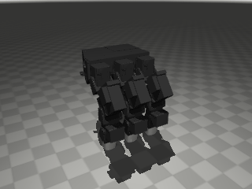

# Walking LEAP

Reinforcement learning for **finger walking with the LEAP Hand V1**: a 16-DOF
anthropomorphic hand, turned palm-down, that should learn to walk on its
fingers. The long-term goal is emergent locomotion, directional control,
robustness and sim-to-real deployment on the physical hand.


*Nominal pose after settling, three views (3/4, side, front). Axes show the palm
(base) frame: red +x = forward (wrist → fingertips), green +y = thumb side,
blue +z = back of the hand. Orange dots are the four ground contacts.*

## Status

**Foundation only.** The robot, the physics and the mjlab task are in place and
tested; PPO is configured and passes smoke tests. **No policy has been trained**
and nothing here demonstrates locomotion yet. See [PLAN.md](PLAN.md).

| Zero action: drops ≤ 5 mm and stands | Joint sweep (gravity off): each digit in turn | Random actions: untrained behavior |
| :---: | :---: | :---: |
|  |  |  |

All media are rendered by [`docs/render_media.py`](docs/render_media.py) with
the same model, physics options and action mapping as the environment.

## Technical stack

| Component | Version | Role |
| --- | --- | --- |
| [mjlab](https://github.com/mujocolab/mjlab) | 1.6.1 (pinned) | Managers, task registry, `train`/`play` CLIs, viewers |
| MuJoCo / MuJoCo Warp | 3.11.0 | Physics (CPU) / batched GPU physics |
| [RSL-RL](https://github.com/leggedrobotics/rsl_rl) | 5.4.2 (via mjlab) | PPO |
| PyTorch | 2.15 (via mjlab) | Networks |
| [uv](https://docs.astral.sh/uv/) | tested 0.12.7 | Environment and lock file |
| [Weights & Biases](https://wandb.ai) | 0.28.2 (capped < 0.29, see AGENTS.md) | Optional logger; used by cluster jobs |

## Repository layout

```
src/walking_leap/
  __init__.py      Registers Walking-Leap-Flat-v0 (loaded via the mjlab.tasks entry point)
  robot.py         MJCF loading, floating base, actuators, collisions, nominal pose
  env_cfg.py       Scene, sim, observations, actions, command, rewards, terminations, metrics
  agent_cfg.py     PPO runner / network configuration
  mdp.py           The few MDP terms mjlab does not provide
  assets/leap_hand/  Unmodified MuJoCo Menagerie right_hand.xml + meshes (MIT)
cluster/
  env.sh           uv locations on Alliance Canada clusters (sourced by jobs)
  train.sbatch     Slurm job: one training run (one per array task)
tests/
  test_robot.py    Model structure and physics (plain MuJoCo, CPU)
  test_env.py      mjlab environment (GPU if available, else CPU)
docs/
  render_media.py  Renders the README images/GIFs into docs/media/
PLAN.md            Roadmap and verified progress
AGENTS.md          Conventions for contributors and coding agents
```

## Installation

Requirements: Linux x86-64; an NVIDIA GPU with a recent driver for training
(tested: RTX 5060 Laptop 8 GB, driver 595, CUDA 13.2). Viewing, tests and
smoke runs also work on the CPU, only slower.

```sh
git clone git@github.com:BrikHMP18/walking-leap.git && cd walking-leap
uv sync
uv run list-envs        # Walking-Leap-Flat-v0 must be listed
```

## Usage

Visualize the environment without a policy (`--viewer native` opens a MuJoCo
window; `--viewer viser` serves a web viewer at http://localhost:8080):

```sh
uv run play Walking-Leap-Flat-v0 --agent zero    # hold the nominal pose
uv run play Walking-Leap-Flat-v0 --agent random  # uniform random actions
```

Training smoke test (seconds; checks rollouts, PPO updates and checkpoints):

```sh
uv run train Walking-Leap-Flat-v0 --env.scene.num-envs 512 --agent.max-iterations 10
```

Full training is **not** part of the foundation. When phase 5 starts, the entry
point is the same CLI:

```sh
uv run train Walking-Leap-Flat-v0 --env.scene.num-envs 4096
```

Runs are written to `logs/rsl_rl/walking_leap_flat/<date_time>/` (TensorBoard
logs, `params/env.yaml`, `params/agent.yaml`, `model_<iteration>.pt`). Add
`--agent.logger wandb` to log to Weights & Biases instead. Play a checkpoint:

```sh
uv run play Walking-Leap-Flat-v0 \
  --checkpoint-file logs/rsl_rl/walking_leap_flat/<date_time>/model_<iteration>.pt
```

Any config field can be overridden from the CLI (`--env.<field>`,
`--agent.<field>`); see `uv run train Walking-Leap-Flat-v0 --help`.

## Training on an Alliance Canada cluster

`cluster/` holds what Slurm needs: `env.sh` (where uv puts Python, its cache
and the virtualenv) and `train.sbatch` (a job script that calls mjlab's `train`
unchanged). Written for Rorqual (`--gres=gpu:h100:1`); other clusters need
their own GPU type there.

- Code and runs stay in project space (a checkpoint is 1.4 MB). uv, Python and
  the virtualenv (~6.5 GB, ~44k files) go to scratch: they are regenerable, and
  the /project file quota is shared by the whole group. Scratch is purged after
  inactivity; if a job fails at import, rerun `uv sync --frozen` on a login node.
- torch in `uv.lock` is built for CUDA 13.2, so compute nodes need an NVIDIA
  driver ≥ 580. Not yet verified on Rorqual: check `nvidia-smi` in the test job.
- Jobs log to Weights & Biases in offline mode (compute nodes have no internet)
  and still write the TensorBoard files. W&B receives metrics only
  (`upload_model=False`); checkpoints are archived on Hugging Face. After a
  job, sync W&B and upload the run from a login node (below).
- Measured on a Rorqual H100 (interactive job, 2026-11-25, 4096 envs): 1.16 s
  per PPO iteration (~85k env-steps/s), so 3000 iterations take about 1 h; the
  job asks for 1.5 h. The RTX 5060 Laptop takes 1.79 s per iteration.

One-time setup on a login node (login nodes have internet, compute nodes do
not):

```sh
curl -LsSf https://astral.sh/uv/install.sh | sh
cd ~/links/projects/<group>/$USER/repos        # your project space
git clone git@github.com:BrikHMP18/walking-leap.git && cd walking-leap
source cluster/env.sh && uv sync --frozen && mkdir -p logs/slurm
echo 'export SBATCH_ACCOUNT=<account> SALLOC_ACCOUNT=<account>' >> ~/.bashrc  # e.g. def-<pi>_gpu
echo 'export WANDB_USERNAME=<wandb entity>' >> ~/.bashrc
uv run --frozen wandb login                   # API key from https://wandb.ai/authorize
uvx --from huggingface_hub hf auth login      # write token from huggingface.co/settings/tokens
```

Before the first submission, check the environment in a short interactive job
(open a new shell first so the account variables are set):

```sh
salloc --gres=gpu:h100:1 --cpus-per-task=4 --mem=16G --time=0:30:00
source cluster/env.sh && export UV_OFFLINE=1
nvidia-smi                       # driver >= 580
uv run --frozen pytest
uv run --frozen train Walking-Leap-Flat-v0 --env.scene.num-envs 4096 --agent.max-iterations 30
exit
```

Submit from the repository root and follow the job:

```sh
sbatch cluster/train.sbatch               # one run, seed 42
sbatch --array=0-2 cluster/train.sbatch   # seeds 42, 43, 44
squeue -u $USER
tail -f logs/slurm/walking-leap-<job id>.out
```

Arguments after the script go to `train`. If a node fails, resubmit with
`--agent.resume True --agent.load-run <run directory>` to continue from that
run's latest checkpoint.

After the job, on a login node, from the repository root and after
`source cluster/env.sh`:

```sh
uv run --frozen wandb sync --sync-all         # upload the offline runs in wandb/
uvx --from huggingface_hub hf upload <hf user>/walking-leap \
  logs/rsl_rl/walking_leap_flat/<run> runs/<run> --private   # checkpoints, params, git state
```

To view runs locally (TensorBoard, `play`), copy them back:

```sh
rsync -av <cluster>:<repository path>/logs/rsl_rl/ logs/rsl_rl/
```

## Tests

```sh
uv run pytest                              # 23 tests: 14 robot/physics, 9 environment
CUDA_VISIBLE_DEVICES="" uv run pytest      # CPU only (~45 s)
uv run ruff check src tests docs && uv run ruff format --check src tests docs
uv run python docs/render_media.py         # regenerate docs/media/
```

## Design

### Robot (`robot.py`)

The Menagerie MJCF (commit `71f066a`) is kept byte-identical (a test checks its
sha256). Changes are applied in code: a free joint on `palm`; the XML position
actuators (kp = 3, no torque limit) replaced by mjlab actuators; collision
priority so the hand's contact parameters govern ground contact; the palm placed
palm-down in `qpos0`; the XML `<option>` reset (physics options live in
`env_cfg.py`). Masses, inertias, geometry, joint names and limits are untouched
(total mass 0.746 kg).

**Actuators.** Each joint has MuJoCo's native DC-motor model in position mode
(`BuiltinDcMotorActuatorCfg`), parameterized by the Dynamixel XC330-M288-T
datasheet, so the torque–speed limit is physical:

| Parameter | Value | Source |
| --- | --- | --- |
| Supply voltage, stall torque, no-load speed | 5 V, 0.93 N·m, 81 rpm (8.48 rad/s) | Datasheet (ROBOTIS e-manual) |
| Small-signal stiffness | 3.0 N·m/rad | LEAP authors' simulator (`LEAP_Hand_Sim`), Menagerie |
| Damping | back-EMF only, 0.11 N·m·s/rad | Derived from datasheet (≈ LEAP_Hand_Sim's 0.1) |
| Torque limit | 0.5 N·m | LEAP_Hand_Sim; true value set by the servo current limit, **not measured** |
| Armature | 0.001 kg·m² | LEAP_Hand_Sim |
| Joint passive damping / frictionloss | 0 / 0.001 | Datasheet curve already includes gearbox losses / Menagerie |

A plain PD with the same torque cap let joints reach 13–16 rad/s; the DC model
caps them at the 8.48 rad/s no-load speed (tested).

**Nominal pose.** Palm down and level; index, middle and ring flexed under the
front of the palm (mcp 0.9, pip 0.6, dip 0.3 rad, no abduction); thumb swung
down behind (cmc 1.75, axl 0, mcp −0.15, ipl −0.7 rad). The hand stands on four
digit tips: three in front (palm-frame x = +0.017 m) and the thumb behind
(x = −0.129 m). The digits are not treated as symmetric legs. The pose came from
a kinematic search maximizing the CoM's margin inside the support polygon
(29 mm) with every joint ≥ 0.25 rad from its limits. In simulation it stands
with 0.04 N·m peak joint torque, 110 mm palm clearance, 0.5° tilt and < 1 mm
drift over 4 s. It is a tall stance; whether it suits walking is open (phase 5).

**Contacts.** Every box/mesh collision primitive of the palm and digits can
touch the ground and the other digits (Menagerie's contact exclusions, palm vs.
proximal links and between finger bases, are kept). Friction comes from the model: 0.5 on fingertips, 0.2 elsewhere
(not measured).

### Environment (`env_cfg.py`)

| | |
| --- | --- |
| Physics | 0.002 s step (500 Hz), implicitfast, elliptic cones, impratio 1, Newton 100 / 50 line-search iterations |
| Control | decimation 10 → 50 Hz policy |
| Episode | 10 s, flat plane, reset to the nominal pose with random yaw and a 0–5 mm drop |
| Command | constant `vx = 0.05 m/s`, `vy = wz = 0`, palm frame |
| Actions (16) | `target = nominal + 0.25 · action`, clipped to joint limits |

Frames: world z up; palm frame +x forward, +y thumb side, +z dorsal. Palm-down
standing is the identity orientation, so mjlab's body-frame quantities need no
extra rotation.

Observations (no noise or delay yet):

| Group | Terms | Dim | Real-robot source |
| --- | --- | --- | --- |
| actor | palm angular velocity (body) | 3 | **IMU required** (not on the stock hand) |
| actor | projected gravity (body) | 3 | **IMU required** (attitude estimate) |
| actor | joint position − nominal, joint velocity | 16 + 16 | Dynamixel encoders |
| actor | previous action, velocity command | 16 + 3 | Policy state |
| critic | actor terms + palm linear velocity, palm height, per-digit ground contact and force, palm contact | 78 | Simulator only (privileged) |

Rewards (rates per second, multiplied by the 0.02 s step):

| Term | Weight | Definition |
| --- | --- | --- |
| `track_lin_vel` | 2.0 | exp(−(‖v_cmd,xy − v_xy‖² + v_z²) / 0.05²) |
| `track_ang_vel` | 0.5 | exp(−(ω_z² + ‖ω_xy‖²) / 0.5²) (zero yaw command) |
| `palm_height` | 1.0 | exp(−(max(0.08 − h, 0) / 0.02)²), one-sided |
| `upright` | 1.0 | exp(−‖g_xy‖² / 0.2) |
| `joint_torques` | −0.2 | Σ τ² |
| `action_rate` | −0.05 | Σ (a_t − a_{t−1})² |
| `palm_contact` | −2.0 | 1 if the palm touches the ground |

No gait timing, contact sequence, reference motion or symmetry term. The weights
are initial values and have not been tuned by training.

Terminations: time limit (truncation, not failure), non-finite state, palm tilt
> 70°, palm on the ground continuously > 1 s. Metrics logged separately from the
reward (`Episode_Metrics/*`): forward velocity, net displacement, palm contact
fraction, ground-contact fraction per digit (`digit_contact_{if,mf,rf,th}`; a
digit near 1.0 while the hand travels is dragged, not stepped), sliding speed of
the fingertip pads in contact (`tip_slip_speed`, the velocity of the material
point at the contact, so rolling reads zero), actuator saturation fraction,
mechanical power (mechanical output, not electrical consumption), plus mjlab's
velocity-tracking errors.

### PPO (`agent_cfg.py`)

RSL-RL PPO through mjlab's runner: separate actor and critic MLPs
(256-128-64, ELU, empirical observation normalization), Gaussian policy with
initial std 1.0, mjlab's default hyperparameters (lr 1e-3 adaptive,
γ 0.99, λ 0.95, clip 0.2, entropy 0.005, 5 epochs × 4 mini-batches, 24 steps
per env), seed 42, TensorBoard logging.

### Simulation-specific decisions

- `impratio` is 1, not the Menagerie's 100: with 100, MuJoCo Warp 3.11 contact
  sensors returned NaN forces in about 1 in 10⁶ env-steps (physics stayed finite).
- Solver iterations stay at mjlab's defaults (100 / 50). With mjlab's quadruped
  setting (10 / 20), elliptic cones do not converge and the standing hand creeps
  32 mm in 4 s.
- Contact buffers are set explicitly (`nconmax=64`, `njmax=256` per world);
  automatic sizing ran out of memory at 4096 envs on 8 GB.
- Elliptic cones cost throughput: ~51k vs. ~85k env-steps/s for pyramidal
  (4096 envs, RTX 5060 Laptop).
- In MuJoCo Warp the fingertip contacts of the standing hand flicker: at zero
  action each digit reads no ground contact in about 3 % of policy steps (239 of
  256 envs, up to 38 on/off switches in 4 s) although the hand does not move
  (tip slip ~2 µm/s). CPU MuJoCo with the same options keeps all four contacts
  continuously (penetration ~0.2 µm). The cause is not established (float32
  precision against the sub-micron penetration is a candidate). Per-digit
  contact metrics therefore read ~0.97, not 1.0, at rest.
- `mdp.VelocityCommand` is mjlab's velocity command without its Viser joystick,
  whose sliders start at 0.1 and crash the viewer for this 0.05 m/s command.

## Known limitations

- No trained policy; locomotion is not demonstrated.
- Actuator torque limit, stiffness and armature come from the LEAP authors'
  simulator, not from measurements on hardware; friction coefficients come from
  the Menagerie model.
- The actor uses angular velocity and gravity direction that would need an IMU
  on the palm; its mass, noise and latency are not modelled.
- No observation noise, actuation delay or domain randomization (nominal physics
  first, by design).
- Joint conventions differ from the LEAP hardware API: the API orders each finger
  (side, forward, pip, dip) while the MJCF orders (mcp, rot, pip, dip), and the
  API's thumb limits (`LEAPsim_limits`) differ from the Menagerie ones. Both must
  be reconciled before deployment.
- The hand's real mass is not verified (no official figure found); the model
  has 0.746 kg.
- Static support is verified in simulation only, for one nominal pose.

## References and acknowledgments

- mjlab — https://github.com/mujocolab/mjlab, docs https://mujocolab.github.io/mjlab/;
  structure follows the external-robot example https://github.com/mujocolab/anymal_c_velocity
- MuJoCo Menagerie LEAP Hand model (MIT) —
  https://github.com/google-deepmind/mujoco_menagerie/tree/main/leap_hand
- LEAP Hand — https://v1.leaphand.com/; K. Shaw, A. Agarwal, D. Pathak,
  "LEAP Hand: Low-Cost, Efficient, and Anthropomorphic Hand for Robot Learning",
  RSS 2023
- LEAP Hand API — https://github.com/leap-hand/LEAP_Hand_API; LEAP Hand simulator
  (actuator values) — https://github.com/leap-hand/LEAP_Hand_Sim
- ROBOTIS XC330-M288-T e-manual — https://emanual.robotis.com/docs/en/dxl/x/xc330-m288/
- MuJoCo, MuJoCo Warp, RSL-RL, PyTorch

## License

MIT (see [LICENSE](LICENSE)). The LEAP Hand model keeps its own MIT license in
`src/walking_leap/assets/leap_hand/LICENSE`.
