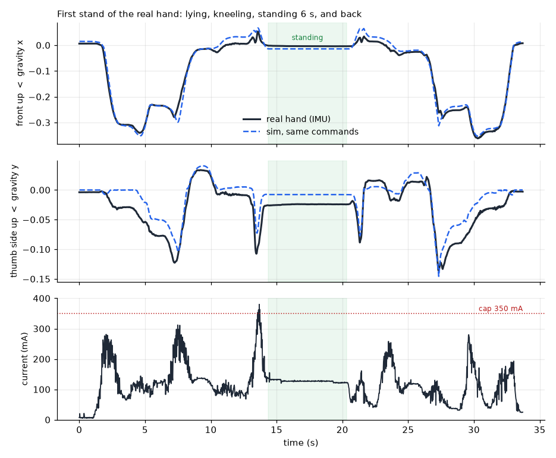
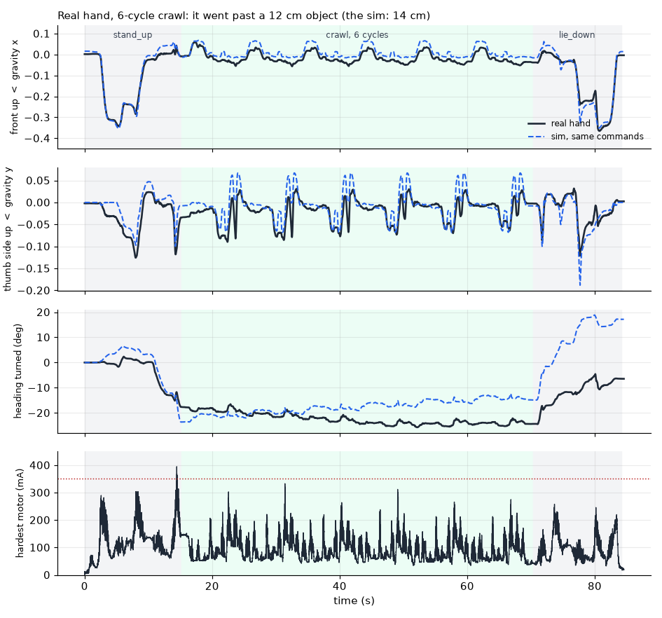
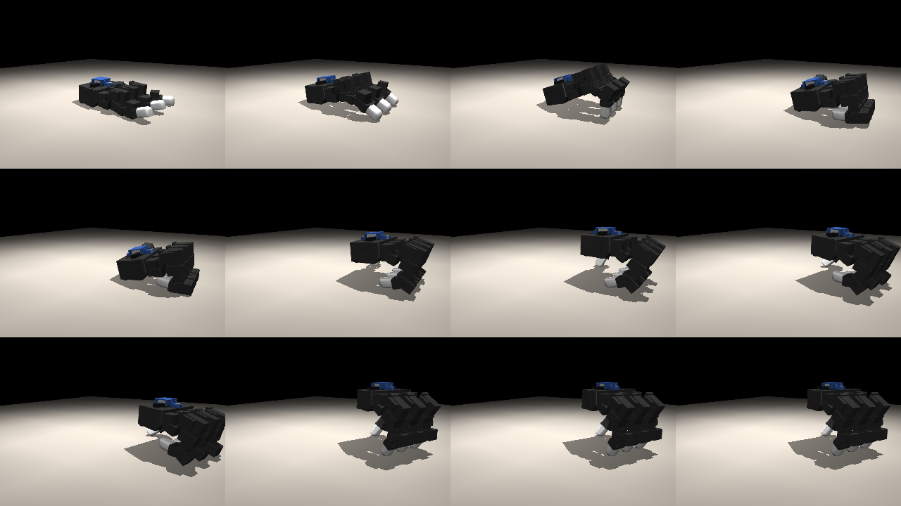

# The real hand: first stand, push-ups and a scripted crawl

The first runs on the physical LEAP Hand. **No learned policy moved the hand.** Every
motion here is a script: joint targets at 50 Hz, written and checked in simulation
first, then played open loop on the hand. The point was to collect sim-to-real data
before the next training batch, and to have a control loop that works end to end.

## In short

- **It stands up on its own, does push-ups, sways, lifts one finger at a time, and
  crawls forward.** Six cycles of the scripted crawl took it past a 12 cm object (the
  simulation says 14 cm). Every run but one finished standing and lay back down by
  itself; that one was cut by a bug in our loop (it let go of the torque while
  standing: the hand sank onto its fingers, no impact), since fixed.
- **The simulator is close.** Given the same motor commands, the simulated palm's
  "down" stays within about 1.6° of the real IMU's on average, over five runs and
  every kind of motion (95 % of the time within about 3°).
- **What it gets wrong:** how much the hand turns while it shuffles (the sim turns about twice as
  much when standing up and lying down, and the other way while crawling), and how
  far it rolls when a finger lifts (the sim rolls about twice as far).
- **For the next batch:** servo stiffness of at least about 2.2 N·m/rad at the gains used
  (the model's 3.0 fits about as well; 1.6 does not); the stock
  fingertips on wood; LEAP's own thumb limits; the IMU on the back. Randomize heading
  slip and roll compliance, not only friction.
- **The trained `hello` policy ran in the shadow** (computing from the real sensors,
  sending nothing): its targets stayed 0.046 rad from the clip on average, the same as
  in simulation (0.048).

## The hand as it was

- LEAP Hand V1 (right), 16 Dynamixel XC330-M288-T, **stock fingertips** (no socks),
  on a rough wooden table. Current limit 350 mA, position gains 1200 / 0 / 600
  (abduction motors at 0.75 of that). No safety line.
- The TM171 IMU on its printed holder on the back of the hand (the model's
  `as_built` holder), its USB cable and the hand's two cables free.
- In the simulator: `robot.get_spec(as_built=False)` **plus LEAP's own thumb limits**
  and the IMU (`add_imu`). The plain stock model keeps Menagerie's shifted thumb
  limits, which made a first comparison look perfect for the wrong reason.

## What was run

| Run | What it does | Result |
| --- | --- | --- |
| each joint alone | +0.12 rad and back, lying flat | all 16 follow their own command; pushing with the fingers tilts the IMU the way the simulation says |
| thumb probe | each thumb joint alone to its lower limit, lying flat | all reach it with about 100 mA: no joint stop |
| stand up, lie down | lying palm down -> kneel on the fingers -> fold the thumb under -> folded-thumb stance at about 128 mm | 7 stand-ups, none fell. Palm level within 2.5° standing |
| push-ups | palm down 20, 35, 35 (fast), 45 mm and up 10 mm | done, at most 2.2° from the simulation |
| sway | palm moved and tilted around the stance (x, y, yaw, pitch, roll) | done, at most 1.8° from the simulation |
| taps | each finger lifted 10 mm in turn, palm shifted off it first | done, at most 7.7° from the simulation |
| `hello` opening, policy in the shadow | the first 4.6 s of `hello` (two push-ups and a stretch), played open loop | done; the policy's targets 0.046 rad from the clip on average |
| crawl, 3 cycles | see below | done; it moved forward (not measured) |
| crawl, 6 cycles | see below | done; **past a 12 cm object** (simulation: 14 cm) |

Motor temperatures stayed at 21-24 °C. The hardest-working motor while standing used
about 130 mA of the 350; on the way up the ring finger touches the limit for an instant.

*The first stand. Black: the real IMU. Dashed: the simulation given the same motor commands.*

*The 6-cycle crawl. From the top: front up or down, thumb side up or down, heading
(gyro integrated), and the current of the hardest-working motor.*

## How the scripts were made

- **Standing up** cannot be a straight move: going straight to either stance tips the
  hand onto its ring side in simulation, because the thumb, stretched out sideways,
  cannot carry its share at 350 mA. Five keyframes were found by a cross-entropy
  search in plain MuJoCo, on simulations chosen to be hard (soft and weak motors,
  slippery and grippy floors, a steady pull like cables, 20 ms of delay, offsets on
  every joint). Then 70 random simulated hands: 70 stood up and lay back down.

  

- **Push-ups, sway, taps and the crawl** are written like `clips.py` writes `hello`:
  a path for the palm and a spot on the ground for each foot, solved frame by frame
  so that every planted fingertip stays where it is (stock fingertips, 0.2 mm worst
  error). Then each one is played on 45 random simulated hands before it touches the
  real one.
- **The crawl** is a quasi-static shuffle: the palm moves forward over the fingers,
  which unloads the thumb to about a tenth of the weight, and the thumb is dragged
  forward along the table. Then each finger in turn: the palm shifts away from it,
  it lifts 9 mm, moves 23 mm forward and comes down. About 9 s a cycle. Its 14
  numbers (stride, shifts, heights, timings) were tuned on six simulated hands; on 45
  random ones it always finished, at 63 to 95 mm for 3 cycles.

| Clip | Seconds | Random simulated hands that finished standing |
| --- | --- | --- |
| push-ups | 17.6 | 45 of 45 |
| sway | 23.8 | 45 of 45 (after making its ring-side moves smaller: 42 of 45 before) |
| taps | 12.7 | 45 of 45 |
| crawl, 3 cycles | 28.1 | 45 of 45, 77 mm forward (median) |
| `hello`, whole, open loop | 22.9 | 24 of 45: written for the socks; not played on the real hand |
| `hello` opening | 5.1 | 45 of 45 |

## Simulation against the real hand

Each run's exact motor commands, replayed in plain MuJoCo from the real starting pose,
on a grid of stiffness and fingertip friction. "Down" is the gravity direction the
IMU measures in the palm's frame.

| Stiffness (N·m/rad) | Friction | "Down" off, on average | 95 % under | Joints off, on average |
| --- | --- | --- | --- | --- |
| 1.3 | 0.3 | 4.0° | 20.5° | 23 mrad |
| 1.3 | 0.8 | 1.8° | 3.8° | 22 mrad |
| 1.6 | 0.5 | 1.6° | 3.1° | 15 mrad |
| 2.2 | 0.8 | 1.6° | 3.2° | 11 mrad |
| 2.6 | 0.8 | 1.7° | 3.2° | 10 mrad |
| 3.5 | 0.8 | 1.8° | 3.4° | 10 mrad |

- **Stiffness:** the IMU barely tells 1.6 from 3.5, but the joints follow their commands
  like a 2.2-2.6 servo (the remaining 10 mrad don't go down with more). The servo's
  own law gives 3.1 mA per mrad of error at these gains; that is 1.6 N·m/rad only if
  1 mA makes 0.517 mN·m (the datasheet's stall point), so the motor's torque per amp is
  probably higher than that. **Not measured; the torque cap of 0.18 N·m rests on the
  same number.**
- **Friction:** below 0.5 the stand-up goes wrong in simulation (the 20° row). Above it,
  these slow motions can't tell.
- **Heading:** the real hand turned −12° to −18° while standing up and +17° lying
  down; the simulation, −24° and +32° (up to twice as much). While crawling, real −5° to −7°, simulation
  +4° to +10°. How the fingertips slip and turn on wood is the clearest gap.
- **Roll when a finger lifts:** the simulated palm rolls about twice as far as the real one
  (the "thumb side" plot above).
- **The thumb:** in one early test the thumb stopped at the current limit with
  `th_cmc` at −0.17 and `th_mcp` at −0.90. Alone, each joint goes to its limit: it was
  the thumb pressing on the table in that pose, which the model had in the air.
- **How the weight is shared** standing: the real index carries almost nothing (about
  15 mA a joint), the middle and ring fingers most. The simulation spreads it more evenly.

## What this does not tell

- Anything about a learned policy driving the hand: the policy only ran in the shadow.
- Balance when pushed, faster gaits, the foot socks, other floors.
- The crawl's distance is one measurement against an object, not a track; the 3-cycle
  crawl was not measured.
- The torque the motors really make.

## For the next training batch

1. The hand as it is: stock fingertips (or socks once printed and measured), LEAP's own
   thumb limits, the IMU and its holder.
2. Servo stiffness about 2.2-3.0 N·m/rad at 1200 / 0 / 600 (the joints rule out 1.6); randomize
   around it.
3. Randomize what doesn't match: rotational slip of the fingertips (heading), and the
   palm's roll when a finger lifts. Fingertip friction 0.5-1.0 on wood.
4. Measure the torque per amp before trusting the 0.18 N·m cap.

## How it was run

A 50 Hz loop on the computer the hand is plugged into, in plain Python: it reads the
motors (100 Hz, through our driver, which is not public) and the IMU (400 Hz), sends
one target per tick, and stops on its own at 40° of tilt, 15° away from what the
simulation predicted for that moment, a motor error, a silent sensor, a motor at its
current limit for 1.5 s, or a stop request (then it lies down first). It logs every
motor state, every IMU reading and every command. The same loop also runs the
animation policies of this repo (`Walking-Leap-Motion-*`), exported to plain numpy
and checked against the ONNX export (largest difference 3e-7). The loop and the
simulation tools around it are kept outside this repository for now, because the
loop imports the private driver.
