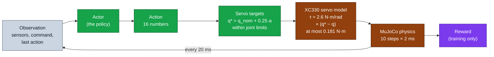
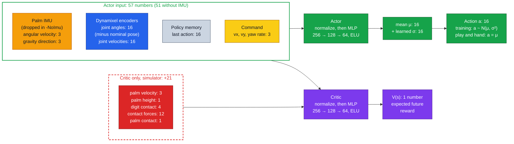
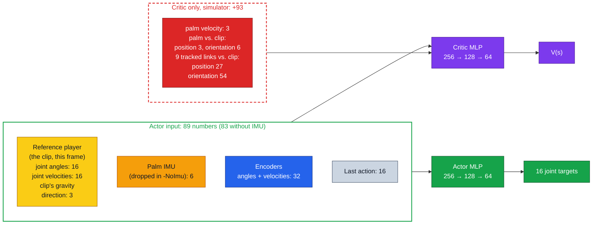
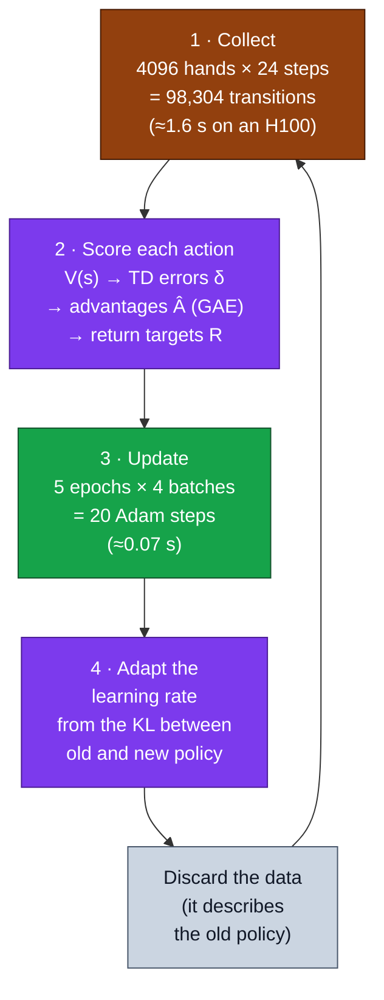
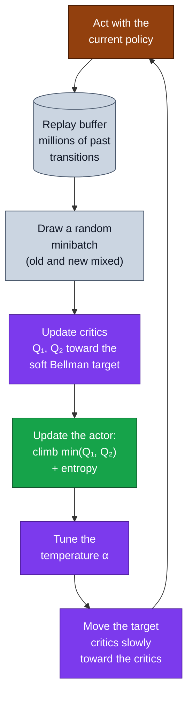
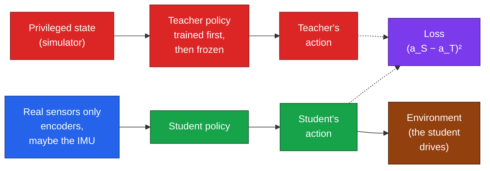

# RL notes: what the policy sees, what it does, how it learns

Notes to keep the whole picture in mind: the network's inputs and outputs for this
hand, how PPO trains it (intuition, equations, how the numbers move during a real
run), and how SAC, TD3 and distillation differ. Every number comes from this
repository's configuration (`env_cfg.py`, `motion_cfg.py`, `agent_cfg.py`), the
installed libraries (mjlab 1.6.1, rsl-rl-lib 5.4.2) or the run named in the text.

**Colors.** The same color means the same thing in every diagram, table and
equation:

| | Meaning |
| --- | --- |
| 🟩 green | the actor: the policy and its actions, what runs on the hand |
| 🟪 purple | training only: the critic, rewards, losses, learning-rate tuning |
| 🟧 orange | the palm IMU (removed in the `-NoImu` tasks) |
| 🟦 blue | the Dynamixel encoders |
| 🟨 yellow | what the task asks for: the velocity command or the clip |
| ⬜ gray | memory and bookkeeping: the last action, the observation vector, data |
| 🟥 red | known only in simulation (privileged) |
| 🟫 brown | the simulated world: servo model and physics |

In the equations, $\textcolor{#16a34a}{\text{green}}$ marks the actor's terms and
$\textcolor{#8b5cf6}{\text{purple}}$ the critic's.

## 1. The control loop

Every 20 ms (50 Hz) the policy reads an observation and sends 16 joint targets. The
physics runs ten 2 ms steps in between. During training 4096 hands run this loop in
parallel on the GPU (MuJoCo Warp); on the real hand it is one hand and the real
sensors.

The servo box is the real hand's model (`robot.actuator_cfg` with
`MEASURED_STIFFNESS` and `API_EFFORT_LIMIT`; the motor's torque-speed curve also
limits it). On the hand the same 16 targets go to the Dynamixels' own position
controllers.

## 2. The networks for walking (`Walking-Leap-Flat-v3`)

Two separate networks, the same shape: the **actor** chooses the actions and is
the only one deployed; the **critic** estimates how good the current situation is
and exists only to train the actor. The critic may see what only the simulator
knows (privileged information); the actor may not, because it must run on the
hand (AGENTS.md, "Keep actor observations deployable").

| Actor term | Dim | Source on the real hand |
| --- | --- | --- |
| 🟧 `base_ang_vel` (palm frame) | 3 | IMU gyro (dropped in `-NoImu`) |
| 🟧 `projected_gravity` (palm frame) | 3 | IMU attitude (dropped in `-NoImu`) |
| 🟦 `joint_pos` − nominal | 16 | Dynamixel encoders |
| 🟦 `joint_vel` | 16 | Dynamixel encoders |
| ⬜ `actions` (previous) | 16 | the policy's own last output |
| 🟨 `command` (vx, vy, yaw rate) | 3 | the user or a planner |

Size: the actor has 57,056 parameters with the IMU (55,520 without); the critic has
78 inputs and one output. Small networks: the hard part is the physics and the
reward, not the network.

**Normalization.** Each input is shifted and scaled by a running mean and standard
deviation measured during training, so that a joint angle (~1 rad) and a velocity
(~10 rad/s) arrive on the same scale. The statistics are saved with the weights and
are part of the exported policy.

**ELU** is the activation between layers: f(x) = x for x > 0, eˣ − 1 otherwise.

**Output.** The actor gives a mean μ for each of the 16 joints; σ is one learned
number per joint that does not depend on the state. Training samples the action
from the Gaussian N(μ, σ²) to explore; `play`, the ONNX export and the hand use μ
directly.

## 3. The networks for imitation (`Walking-Leap-Motion-Crawl-Flat-v0`)

Same networks, different inputs: the command is replaced by the clip. A small
reference player steps through the clip and gives the actor the frame it should be
in now.

The actor never sees where the hand is or which way it faces, only the clip's
joints and tilt; position and heading appear only in the critic and the reward.

## 4. The basic quantities

At each step t the hand is in a state s_t, takes an action a_t and receives a reward
r_t. Training looks for the weights θ that maximize the **discounted return**:

$$
J(\theta) = \mathbb{E}\Big[\sum_{t=0}^{\infty} \gamma^t\, \textcolor{#8b5cf6}{r_t}\Big], \qquad \gamma = 0.99
$$

γ sets how far ahead the policy cares: rewards fade with a time constant of
1/(1 − γ) = 100 steps, **about 2 s** at 50 Hz.

The reward is a weighted sum of terms, as rates per second multiplied by the
0.02 s step:

$$
\textcolor{#8b5cf6}{r_t} = \Delta t \sum_i w_i\, f_i(s_t, a_t), \qquad \Delta t = 0.02\ \text{s}
$$

In v3: `track_lin_vel` 2.0, `track_ang_vel` 1.0, `palm_height` 1.0, `upright` 1.0,
`joint_torques` −0.2, `action_rate` −0.05, `palm_contact` −2.0, `tip_slip` −0.2,
`long_air_time` −1.0 (definitions in README "Environment").

Three functions of the policy π:

| | Meaning |
| --- | --- |
| 🟪 V(s) | value: the return expected from state s |
| 🟪 Q(s, a) | the same, first taking action a, then following π |
| 🟪 A(s, a) = Q(s, a) − V(s) | advantage: **how much better than usual** action a was |

The advantage is the signal every policy-gradient method learns from: make actions
with A > 0 more likely and those with A < 0 less likely.

For the Gaussian policy, per joint j:

$$
\log \textcolor{#16a34a}{\pi_\theta}(a \mid s) = \sum_{j=1}^{16} \Big[-\frac{(a_j - \textcolor{#16a34a}{\mu_j})^2}{2\textcolor{#16a34a}{\sigma_j}^2} - \ln \textcolor{#16a34a}{\sigma_j} - \tfrac{1}{2}\ln 2\pi\Big]
$$

$$
\textcolor{#16a34a}{H[\pi]} = \sum_{j=1}^{16} \Big(\tfrac{1}{2}\ln(2\pi e) + \ln \textcolor{#16a34a}{\sigma_j}\Big) \approx \sum_{j} (1.42 + \ln \textcolor{#16a34a}{\sigma_j})
$$

The entropy H measures how wide the distribution is. It goes **negative** once σ is
small: 16 joints at σ = 1 give 22.7, at σ = 0.04 they give −28.8. That is normal for
continuous distributions.

## 5. PPO (what this repository uses)

**Intuition.** Try things with the current policy, compare how each action turned
out against what the critic expected, and make the better-than-expected actions
more likely. But change the policy only a little each time: a big jump can wreck a
gait that already works, and the data collected says nothing reliable about a
policy far from the one that collected it.

One **iteration**:

3000 iterations (crawl) are 295 million transitions; 6000 (v3) are 590 million.

### Step 2: how good was each action

The **TD error** is the critic's surprise at one step: what happened against what
it expected.

$$
\textcolor{#8b5cf6}{\delta_t} = r_t + \gamma\, \textcolor{#8b5cf6}{V(s_{t+1})} - \textcolor{#8b5cf6}{V(s_t)}
$$

**GAE** (generalized advantage estimation) adds up the surprises that follow, fading
them with γλ:

$$
\textcolor{#8b5cf6}{\hat{A}_t} = \sum_{l=0}^{\infty} (\gamma\lambda)^l\, \textcolor{#8b5cf6}{\delta_{t+l}}, \qquad \lambda = 0.95
$$

With γλ = 0.94 the sum looks about 1/(1 − γλ) ≈ 17 steps (0.34 s) ahead and
trusts the critic for the rest. λ near 1 looks further but is noisier; λ = 0 uses
one step and the critic's guess. The critic's target is the return estimate
R_t = Â_t + V(s_t). (`rsl_rl/algorithms/ppo.py`, lines 178–181.)

### Step 3: the PPO loss

How much more (or less) likely the new policy makes each collected action:

$$
\textcolor{#16a34a}{\rho_t(\theta)} = \frac{\textcolor{#16a34a}{\pi_\theta}(a_t \mid s_t)}{\pi_{\theta_{\text{old}}}(a_t \mid s_t)}
$$

The **clipped surrogate** objective:

$$
\textcolor{#16a34a}{L^{\text{clip}}(\theta)} = \mathbb{E}_t\Big[\min\big(\textcolor{#16a34a}{\rho_t}\,\textcolor{#8b5cf6}{\hat{A}_t},\ \operatorname{clip}(\textcolor{#16a34a}{\rho_t},\,1-\epsilon,\,1+\epsilon)\,\textcolor{#8b5cf6}{\hat{A}_t}\big)\Big], \qquad \epsilon = 0.2
$$

| | Effect of the clip |
| --- | --- |
| 🟩 Â > 0 (better than expected) | raise that action's probability, but gain nothing beyond +20 % |
| 🟥 Â < 0 (worse than expected) | lower it, but gain nothing beyond −20 % |

So each update stays in a "trust region" around the policy that collected the data.

The **critic** learns to predict the return (squared error, also clipped to ±0.2
around its old value):

$$
\textcolor{#8b5cf6}{L^V(\phi)} = \mathbb{E}_t\big[(\textcolor{#8b5cf6}{V_\phi(s_t)} - \textcolor{#8b5cf6}{R_t})^2\big]
$$

The **total loss**, minimized with Adam (gradient norm clipped at 1.0), as in
`rsl_rl/algorithms/ppo.py`, line 278:

$$
\mathcal{L} = -\textcolor{#16a34a}{L^{\text{clip}}} + c_V\, \textcolor{#8b5cf6}{L^V} - c_H\, \textcolor{#16a34a}{H[\pi_\theta]}, \qquad c_V = 1.0,\ c_H = 0.005
$$

The entropy bonus keeps σ from collapsing too early, so the policy keeps exploring.

### Step 4: the adaptive learning rate

After each minibatch the KL divergence between the old and new policy measures how
far the update went. The learning rate follows it (`ppo.py`, lines 246–249):

| Measured KL | Learning rate |
| --- | --- |
| 🟥 above 0.02 (2 × target) | divided by 1.5 (at least 1e-5) |
| 🟩 below 0.005 (target / 2) | multiplied by 1.5 (at most 1e-2) |

For two Gaussians with the same σ the KL is Σⱼ (Δμⱼ)² / (2σⱼ²): the same change of
the mean counts as a bigger change when σ is small. That is why the learning rate
falls as the policy becomes precise.

### How the numbers move during a run

`Walking-Leap-Motion-Crawl-Flat-NoImu-v0`, seed 42, from its TensorBoard log
(`outputs/hf/runs/2026-11-26_03-27-52_Walking-Leap-Motion-Crawl-Flat-NoImu-v0_s42`,
on Hugging Face):

| Iteration | 0 | 10 | 50 | 100 | 300 | 1000 | 2999 |
| --- | --- | --- | --- | --- | --- | --- | --- |
| 🟪 mean reward per episode | −0.63 | 0.05 | 25.3 | 42.6 | 53.5 | 54.0 | 54.2 |
| 🟫 episode length (of 500) | 23 | 52 | 487 | 500 | 499 | 500 | 500 |
| 🟩 σ, mean of the 16 | 0.98 | 0.80 | 0.45 | 0.25 | 0.061 | 0.047 | 0.041 |
| 🟩 entropy | 22.5 | 19.3 | 9.8 | 0.4 | −22.3 | −26.2 | −28.6 |
| 🟪 learning rate | 0.0015 | 0.0023 | 0.0013 | 0.00087 | 0.00011 | 0.00011 | 0.00026 |
| 🟪 critic loss | 0.029 | 0.015 | 0.0096 | 0.0024 | 0.0039 | 0.00004 | 0.00003 |

Three phases:

1. 🟥 **0–50: stop falling.** With σ ≈ 1 the actions are close to random and the
   hand falls after 23 steps. Advantages are large and learning is fast: by
   iteration 50 episodes nearly reach their full length.
2. 🟨 **50–300: become precise.** σ drops from 0.45 to 0.06 and the reward climbs
   from 25 to 53.5. The learning rate falls tenfold, because with a narrow Gaussian
   each step of the mean counts as a large KL.
3. 🟩 **300–3000: fine-tune.** The reward moves from 53.5 to 54.2; the critic
   predicts almost perfectly; updates become small and the learning rate creeps
   back up.

In TensorBoard or W&B these are `Train/mean_reward`, `Train/mean_episode_length`,
`Policy/mean_std`, `Loss/entropy`, `Loss/learning_rate` and `Loss/value`. A run that
goes wrong usually shows here first: σ that never shrinks (no signal), episodes
that get shorter (it learned to end them, as Flat-v2 did), or a learning rate stuck
at its floor.

## 6. SAC: the off-policy alternative

**Intuition.** Keep every transition in a large memory (the replay buffer) and reuse
each one many times. Learn a critic Q(s, a) that says how good each action is, and
move the actor straight up its slope. And reward randomness itself: among equally
good behaviors, prefer the most random (maximum entropy), which keeps exploring.

The objective adds the entropy to the reward, weighted by a temperature α:

$$
J(\textcolor{#16a34a}{\pi}) = \mathbb{E}\Big[\sum_t \gamma^t \big(\textcolor{#8b5cf6}{r_t} + \alpha\, \textcolor{#16a34a}{H[\pi(\cdot \mid s_t)]}\big)\Big]
$$

Critics, toward a target built with slowly updated copies Q̄ and the smaller of two
estimates (one critic alone overestimates, and the actor exploits the errors):

$$
y = r + \gamma\Big(\min_{i=1,2} \textcolor{#8b5cf6}{\bar{Q}_i(s', a')} - \alpha \log \textcolor{#16a34a}{\pi(a' \mid s')}\Big), \quad a' \sim \textcolor{#16a34a}{\pi(\cdot \mid s')},
\qquad \textcolor{#8b5cf6}{L_{Q_i}} = \big(\textcolor{#8b5cf6}{Q_i(s, a)} - y\big)^2
$$

Actor, through the reparameterized sample a = tanh(μ_θ(s) + σ_θ(s) ⊙ ξ), ξ ~ N(0, I),
so that the gradient flows from Q into the actor:

$$
\textcolor{#16a34a}{L_\pi} = \mathbb{E}_{s,\,\xi}\Big[\alpha \log \textcolor{#16a34a}{\pi_\theta(a \mid s)} - \min_i \textcolor{#8b5cf6}{Q_i(s, a)}\Big]
$$

Temperature, tuned so that the entropy stays near a target (commonly −dim(a), −16
here):

$$
\textcolor{#8b5cf6}{L_\alpha} = -\alpha\,\big(\log \textcolor{#16a34a}{\pi(a \mid s)} + H_{\text{target}}\big)
$$

Target critics: Q̄ ← τQ + (1 − τ)Q̄ with τ ≈ 0.005.

**How it moves.** The buffer fills; α starts high (explore) and drops as the
policy narrows; Q's estimates rise as the policy improves. Every transition is used
many times, so far fewer samples are needed than with PPO, at more computation per
sample.

**PPO against SAC in one line.** PPO learns from returns the current policy really
obtained, then discards them: wasteful but honest and stable. SAC trusts its
learned Q and recycles old data: efficient, but when Q is wrong the actor exploits
the error.

| | PPO | SAC |
| --- | --- | --- |
| ⬜ Data | current policy only, discarded after each iteration | replay buffer, reused |
| 🟪 Critic | V(s) | two Q(s, a) and their slow copies |
| 🟩 Policy update | clipped likelihood ratio × advantage | gradient through Q |
| 🟩 Exploration | learned σ, entropy bonus | entropy in the objective, auto-tuned α |
| ✅ Strength | stable, simple, scales to thousands of parallel envs | sample-efficient |
| ⚠️ Weakness | needs many samples (cheap in simulation) | more hyperparameters, Q errors |
| 📦 In this repository | rsl-rl-lib 5.4.2, through mjlab's runner | not installed |

## 7. TD3 and distillation, briefly

**TD3** is the deterministic cousin of SAC: the actor outputs one action μ(s) and
exploration noise is added to it; it keeps the two critics and their minimum,
smooths the target with noise, and updates the actor every second critic step. Fast
parallel variants of TD3 and SAC (FastTD3, the FlashSAC of the XgoDuck post) adapt
them to thousands of GPU environments; they are newer and less tried.

**Distillation (teacher → student)** is a second stage, not a replacement. A teacher
is trained first with privileged inputs; a student that sees only the real sensors
o then learns to copy it, on the states the student itself reaches (DAgger), so that
it learns to recover from its own mistakes:

$$
\textcolor{#8b5cf6}{L} = \mathbb{E}_{s \sim \textcolor{#16a34a}{\pi_S}}\Big[\big\lVert \textcolor{#16a34a}{\pi_S(o)} - \textcolor{#dc2626}{\pi_T(s_{\text{priv}})} \big\rVert^2\Big]
$$

rsl-rl-lib 5.4.2 includes it (`algorithms/distillation.py`). It is the natural tool
if the no-IMU policies fall short: the teacher can feel what the student cannot.

## 8. Which one here, and why

PPO, through RSL-RL and mjlab's runner, as now:

- The failures so far were reward and model problems (the unbounded sliding penalty
  of v2, digits held up, the dragged thumb), not sample efficiency.
- Every run (v0, v3, the crawl) is PPO with the same networks, so results stay
  comparable.
- Compute is not the limit: 1.2–1.8 s per iteration on an H100.
- rsl-rl-lib 5.4.2 has only PPO and distillation; SAC or TD3 would need a training
  loop of our own, which AGENTS.md allows only for a demonstrated need.

Reconsider an off-policy method if training moves onto the real hand, where each
sample is expensive, or if wall-clock time becomes the bottleneck.

## Glossary

| Term | Meaning here |
| --- | --- |
| step | one policy decision: 20 ms, ten physics steps |
| episode | one try from reset to a fall or the time limit (10 s, 500 steps) |
| rollout | the 24 steps each of the 4096 hands collects per iteration |
| iteration | collect + update; one row of the training log |
| epoch | one pass of the update over the collected data (5 per iteration) |
| minibatch | a quarter of the data (24,576 transitions), one Adam step |
| on-policy / off-policy | learns only from the current policy's data / also from old data |
| privileged | known only in simulation (critic, teacher), never in the actor |
| nominal / randomized | trained on one model / on a range of models, pushes and noise |
