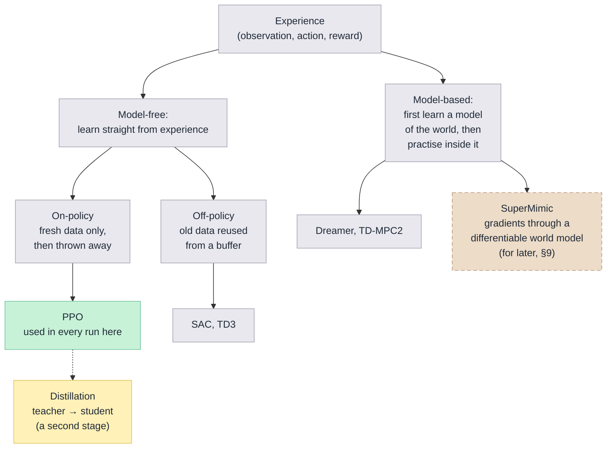
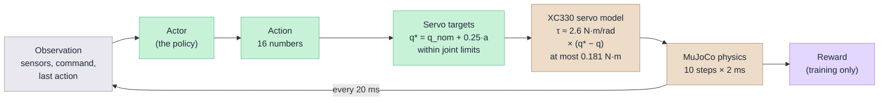
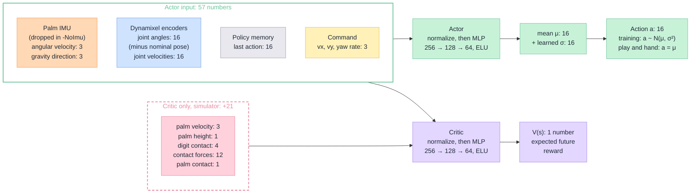
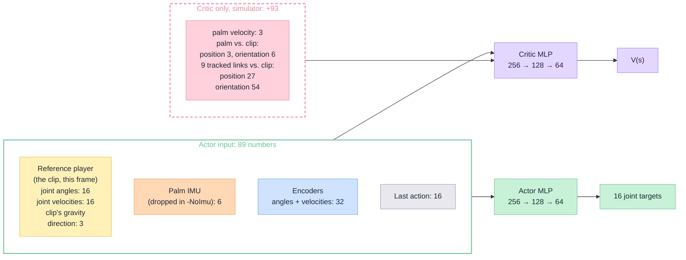
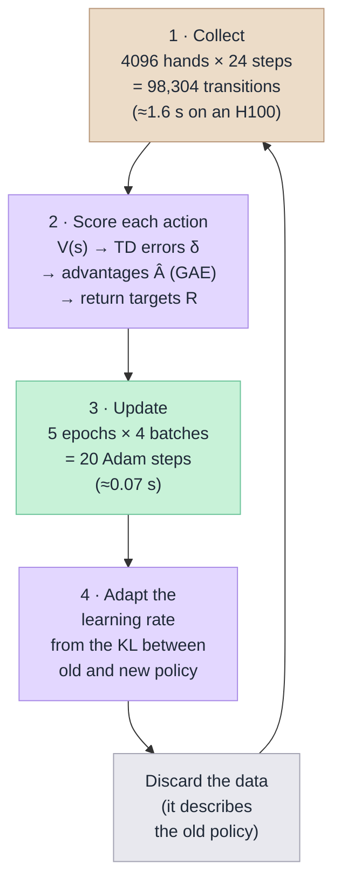
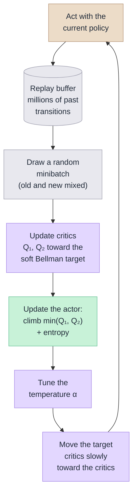
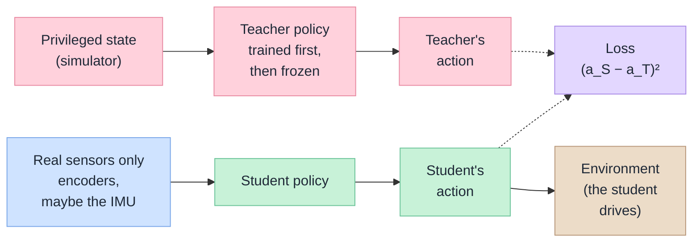
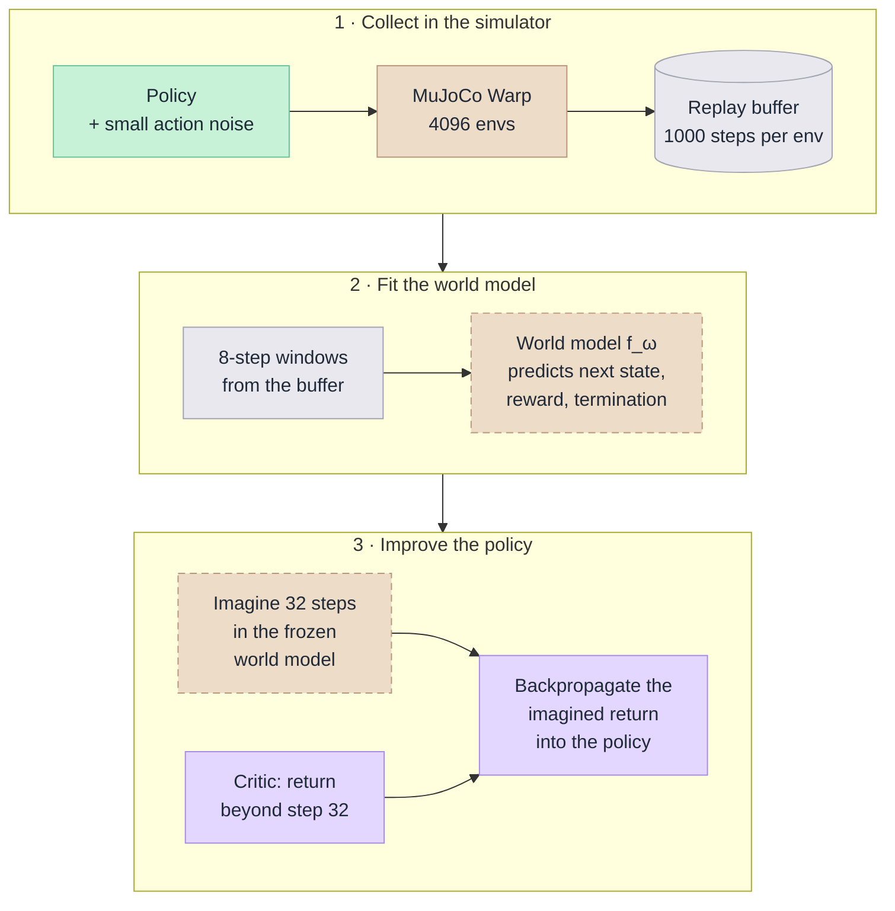

# RL notes: what the policy sees, what it does, how it learns

Study notes for this project. They explain, from the ground up, what the neural
network of the hand receives and returns, how PPO (the algorithm every run here uses)
turns trial and error into a better policy, and how the alternatives work: SAC, TD3,
distillation and, for later, SuperMimic's learned world model. Each idea comes in
the same order: **intuition first, then the equation, then a worked example with
this hand's numbers.**

Every number comes from this repository's configuration (`env_cfg.py`,
`motion_cfg.py`, `agent_cfg.py`), the installed libraries (mjlab 1.6.1, rsl-rl-lib
5.4.2), the run named in the text, or, for SuperMimic, the paper (marked as reported
by its authors).

**Contents.** 1 The big picture · 2 The control loop · 3 The walking networks ·
4 The imitation networks · 5 Basic quantities · 6 PPO · 7 SAC · 8 TD3 and
distillation · 9 SuperMimic (for later) · 10 Summary · Glossary.

**Colors.** In the data-flow diagrams, tables and equations the same color always
means the same thing:

| | Meaning |
| --- | --- |
| 🟩 mint | the actor: the policy and its actions, what runs on the hand |
| 🟪 lavender | training only: the critic, rewards, losses, learning-rate tuning |
| 🟧 peach | the palm IMU (removed in the `-NoImu` tasks) |
| 🟦 blue | the Dynamixel encoders |
| 🟨 butter | what the task asks for: the velocity command or the clip |
| ⬜ gray | memory and bookkeeping: the last action, the observation vector, stored data |
| 🟥 rose | known only in simulation (privileged) |
| 🟫 latte | the simulated world: servo model and physics; dashed border: a *learned* world model |

In the equations: $\textcolor{#3fae7a}{\text{green}}$ = actor,
$\textcolor{#9b7ede}{\text{purple}}$ = critic, $\textcolor{#c0905f}{\text{tan}}$ =
learned world model, $\textcolor{#e06c86}{\text{rose}}$ = privileged teacher.

## 1. The big picture

Reinforcement learning teaches by **trial and error with a score**. The hand tries
something, the simulator says how good it was (the reward), and the policy is
nudged towards what scored well. Two networks share the work, like a player and a
coach:

- the **actor** (the player) decides what to do: 16 joint targets, 50 times a
  second;
- the **critic** (the coach) predicts how well things will go from here. It never
  acts; it tells the actor whether an outcome was better or worse than expected.

The algorithms differ in **how they turn experience into an improvement**:

(In this map only: mint = used here, butter = installed but not used yet, dashed =
for later, gray = not installed.)

## 2. The control loop

Every 20 ms (50 Hz) the policy reads an observation and sends 16 joint targets.
Between two decisions the physics runs ten steps of 2 ms. During training 4096
simulated hands run this loop at once on the GPU (MuJoCo Warp); on the real hand it
is one hand and the real sensors, with the same 16 targets.

**Reading the boxes, with numbers.**

- **Action → target.** The action is not an angle: an action of 1.0 moves a
  joint's target 0.25 rad (14°) away from the nominal standing pose. The policy
  therefore only learns *corrections* around a pose that already stands.
- **Target → torque.** The servo pushes like a spring: 2.6 N·m for every radian
  between target and actual angle, but never more than 0.181 N·m, which is what
  350 mA can give. A target 0.1 rad away asks for 0.26 N·m: the motor saturates.
  This is the real hand's model (`robot.actuator_cfg` with `MEASURED_STIFFNESS` and
  `API_EFFORT_LIMIT`; the motor's torque-speed curve also limits it).
- **Reward.** Only the simulator computes it, and only during training. The real
  hand never sees a reward.

## 3. The networks for walking (`Walking-Leap-Flat-v3`)

**Why two networks?** The actor must run on the real hand, so it may only use what
the hand can measure (AGENTS.md, "Keep actor observations deployable"). The critic
only exists during training, in simulation, so it may cheat: it also sees the palm's
true velocity and height and every contact. A better-informed coach gives better
advice, and the player still plays with its own eyes. This is called an
**asymmetric actor-critic**.

| Actor term | Dim | Source on the real hand |
| --- | --- | --- |
| 🟧 `base_ang_vel` (palm frame) | 3 | IMU gyro (dropped in `-NoImu`: 51 inputs) |
| 🟧 `projected_gravity` (palm frame) | 3 | IMU attitude (dropped in `-NoImu`) |
| 🟦 `joint_pos` − nominal | 16 | Dynamixel encoders |
| 🟦 `joint_vel` | 16 | Dynamixel encoders |
| ⬜ `actions` (previous) | 16 | the policy's own last output |
| 🟨 `command` (vx, vy, yaw rate) | 3 | the user or a planner |

**Why the last action?** The network has no memory of its own. Feeding back what it
did 20 ms ago lets it produce smooth motions and know where the targets already are.

**Size.** The actor has 57,056 parameters with the IMU (55,520 without): small. The
hard part is the physics and the reward, not the network.

**Normalization.** Each input is shifted and scaled by a running mean and standard
deviation measured during training, so that an angle of a fraction of a radian and a
velocity of a few rad/s reach the network on the same scale. The statistics are saved
with the weights and travel with the exported policy.

**ELU**, the activation between layers: f(x) = x for x > 0, eˣ − 1 otherwise. It is
the "bend" that lets a stack of linear layers represent curved functions.

**Output: a mean and a spread.** For each joint the actor gives a mean μ; σ is one
learned number per joint, the same in every state. During training the action is
*sampled* from N(μ, σ²), which is how the policy explores; `play`, the ONNX export
and the hand use μ alone.

## 4. The networks for imitation (`Walking-Leap-Motion-Crawl-Flat-v0`)

Same networks, different task input: the command is replaced by the clip. A small
reference player steps through the clip and shows the actor the pose it should be in
*now* (one frame, no look-ahead).

Without the IMU the actor has 83 inputs. It never sees where the hand is or which
way it faces, only the clip's joints and tilt; position and heading appear only in
the critic and the reward.

## 5. The basic quantities

### Return and discount

At each step t the hand is in a state s_t, takes an action a_t and receives a reward
r_t. Training looks for the weights θ that maximize the **discounted return**, the
sum of all future rewards with the far future counting less:

$$
J(\theta) = \mathbb{E}\Big[\sum_{t=0}^{\infty} \gamma^t\, \textcolor{#9b7ede}{r_t}\Big], \qquad \gamma = 0.99
$$

**Example.** With γ = 0.99 at 50 Hz, a reward 1 s ahead (50 steps) counts 0.99⁵⁰ =
0.61 of its value, 2 s ahead 0.37, 5 s ahead 0.08. The policy effectively plans
about **2 s ahead** (time constant 1/(1 − γ) = 100 steps). A fall it can avoid by
acting now is worth avoiding; a stride 10 s away hardly matters to it.

The reward itself is a weighted sum of terms, written as rates per second and
multiplied by the 0.02 s step:

$$
\textcolor{#9b7ede}{r_t} = \Delta t \sum_i w_i\, f_i(s_t, a_t), \qquad \Delta t = 0.02\ \text{s}
$$

In v3: `track_lin_vel` 2.0, `track_ang_vel` 1.0, `palm_height` 1.0, `upright` 1.0,
`joint_torques` −0.2, `action_rate` −0.05, `palm_contact` −2.0, `tip_slip` −0.2,
`long_air_time` −1.0 (definitions in README "Environment").

### Value, Q and advantage

| | Meaning | In words |
| --- | --- | --- |
| 🟪 V(s) | the return expected from state s | "how well do things usually go from here?" |
| 🟪 Q(s, a) | the same, first taking action a | "and if I do *this* now?" |
| 🟪 A(s, a) = Q(s, a) − V(s) | advantage | "was this action **better than usual**?" |

The advantage is the signal every policy-gradient method learns from: make actions
with A > 0 more likely, those with A < 0 less likely. Rewarding the raw return
instead would be misleading: from a good state even a poor action scores well.

### The Gaussian policy

The probability the policy gives to an action, joint by joint:

$$
\log \textcolor{#3fae7a}{\pi_\theta}(a \mid s) = \sum_{j=1}^{16} \Big[-\frac{(a_j - \textcolor{#3fae7a}{\mu_j})^2}{2\textcolor{#3fae7a}{\sigma_j}^2} - \ln \textcolor{#3fae7a}{\sigma_j} - \tfrac{1}{2}\ln 2\pi\Big]
$$

and its **entropy**, a measure of how spread out (how exploratory) it is:

$$
\textcolor{#3fae7a}{H[\pi]} = \sum_{j=1}^{16} \Big(\tfrac{1}{2}\ln(2\pi e) + \ln \textcolor{#3fae7a}{\sigma_j}\Big) \approx \sum_{j} (1.42 + \ln \textcolor{#3fae7a}{\sigma_j})
$$

**Example.** At the start σ = 1: each joint target jitters by about ±0.25 rad (14°)
around what the network means, and H = 22.7. At the end of the crawl run σ ≈ 0.041:
about ±0.01 rad (0.6°), and H ≈ −28.6. Entropy going **negative** is normal for
continuous distributions; it only says the bell curve is narrow.

Check yourself

- Why does the policy care little about a reward 10 s away? (γ¹⁰⁰⁰… 0.99⁵⁰⁰ ≈ 0.007.)
- An action from a great state earns a high return. Is it a good action? (Only if
  its advantage is positive: better than what usually happens from that state.)
- What does σ = 0.04 mean in degrees at the joint? (0.04 × 0.25 rad ≈ 0.6°.)

## 6. PPO: what this repository uses

**Intuition.** Like tuning a recipe by tasting: cook many variations with the current
recipe (collect), ask the coach which ones came out better than expected (score),
shift the recipe a little towards those (update), and never change it so much at
once that a dish that already worked is ruined (clip). Then cook a fresh batch: the
old tastings described the old recipe.

One **iteration**:

Almost all the time goes into collecting (1.6 s) and very little into learning
(0.07 s): PPO is cheap per update but hungry for data. 3000 iterations (crawl) are
295 million transitions; 6000 (v3) are 590 million.

### Step 2: how good was each action

**TD error: the critic's surprise at one step.** What happened (the reward plus the
value of where the hand ended up) minus what the critic expected:

$$
\textcolor{#9b7ede}{\delta_t} = r_t + \gamma\, \textcolor{#9b7ede}{V(s_{t+1})} - \textcolor{#9b7ede}{V(s_t)}
$$

**Example.** The critic expected V(s_t) = 5.20. The step earned r_t = 0.10 and led
to a state worth V(s_t+1) = 5.00. Then δ = 0.10 + 0.99 × 5.00 − 5.20 = −0.15: a bit
worse than expected, so that action should become a little less likely.

**GAE: blending surprises over the next steps.** One step's surprise is noisy; the
surprises that follow also say something about this action. GAE adds them up,
fading each by γλ:

$$
\textcolor{#9b7ede}{\hat{A}_t} = \sum_{l=0}^{\infty} (\gamma\lambda)^l\, \textcolor{#9b7ede}{\delta_{t+l}}, \qquad \lambda = 0.95
$$

**Example.** γλ = 0.94: the surprise 17 steps later (0.34 s) still counts 35 %, and
beyond that the critic's estimate takes over. λ = 0 would trust only one step and the
critic (low noise, but biased if the critic is wrong); λ = 1 would add up real
rewards to the end (unbiased, but noisy). 0.95 is the usual compromise. The critic's
training target is R_t = Â_t + V(s_t) (`rsl_rl/algorithms/ppo.py`, lines 178–181).

### Step 3: the PPO loss

**The ratio.** How much more (or less) likely the updated policy makes each action
that was actually taken:

$$
\textcolor{#3fae7a}{\rho_t(\theta)} = \frac{\textcolor{#3fae7a}{\pi_\theta}(a_t \mid s_t)}{\pi_{\theta_{\text{old}}}(a_t \mid s_t)}
$$

ρ = 1 means unchanged; ρ = 1.3 means 30 % more likely than before.

**The clipped objective.** Raise the probability of good actions, lower that of bad
ones, but stop pushing once a probability has moved 20 %:

$$
\textcolor{#3fae7a}{L^{\text{clip}}(\theta)} = \mathbb{E}_t\Big[\min\big(\textcolor{#3fae7a}{\rho_t}\,\textcolor{#9b7ede}{\hat{A}_t},\ \operatorname{clip}(\textcolor{#3fae7a}{\rho_t},\,1-\epsilon,\,1+\epsilon)\,\textcolor{#9b7ede}{\hat{A}_t}\big)\Big], \qquad \epsilon = 0.2
$$

**Example.** A good action, Â = +2, already made 50 % more likely (ρ = 1.5): the
unclipped term would be 3.0, the clipped one 1.2 × 2 = 2.4, and the min keeps 2.4, a
constant, so there is no gradient left to push it further. A bad action, Â = −2,
already halved (ρ = 0.5): the min picks 0.8 × (−2) = −1.6, constant again. Each
update stays in a "trust region" around the policy that collected the data.

| | Effect of the clip |
| --- | --- |
| 🟩 Â > 0 (better than expected) | raise that action's probability, up to +20 % |
| 🟥 Â < 0 (worse than expected) | lower it, down to −20 % |

**The critic's loss.** Plain regression: predict the return target (the change is
also clipped to ±0.2 around the old prediction):

$$
\textcolor{#9b7ede}{L^V(\phi)} = \mathbb{E}_t\big[(\textcolor{#9b7ede}{V_\phi(s_t)} - \textcolor{#9b7ede}{R_t})^2\big]
$$

**The total loss**, minimized with Adam (gradient norm clipped at 1.0), exactly as
`rsl_rl/algorithms/ppo.py`, line 278, writes it:

$$
\mathcal{L} = -\textcolor{#3fae7a}{L^{\text{clip}}} + c_V\, \textcolor{#9b7ede}{L^V} - c_H\, \textcolor{#3fae7a}{H[\pi_\theta]}, \qquad c_V = 1.0,\ c_H = 0.005
$$

Three jobs in one line: improve the actor, teach the critic, and keep a little
exploration (the entropy bonus stops σ from collapsing too early).

### Step 4: the adaptive learning rate

**Intuition.** A thermostat on the step size. After each minibatch, the KL
divergence between the old and the new policy measures how far the update went, and
the learning rate is turned down or up to keep it near a target of 0.01 (`ppo.py`,
lines 246–249):

| Measured KL | Learning rate |
| --- | --- |
| 🟥 above 0.02 (2 × target): went too far | divided by 1.5 (at least 1e-5) |
| 🟩 below 0.005 (target / 2): barely moved | multiplied by 1.5 (at most 1e-2) |

For two Gaussians with the same σ the KL is Σⱼ (Δμⱼ)² / (2σⱼ²).

**Example.** Move all 16 means by 0.01. With σ = 0.25 that is a KL of 0.013, fine.
With σ = 0.04 it is 0.5, 25 times the limit. The same nudge is a much bigger change
for a precise policy, so the learning rate has to fall as σ shrinks. You will see
exactly that in the run below.

### How the numbers move during a real run

`Walking-Leap-Motion-Crawl-Flat-NoImu-v0`, seed 42, from its TensorBoard log
(`outputs/hf/runs/2026-11-26_03-27-52_Walking-Leap-Motion-Crawl-Flat-NoImu-v0_s42`,
on Hugging Face):

| Iteration | 0 | 10 | 50 | 100 | 300 | 1000 | 2999 |
| --- | --- | --- | --- | --- | --- | --- | --- |
| 🟪 mean reward per episode | −0.63 | 0.05 | 25.3 | 42.6 | 53.5 | 54.0 | 54.2 |
| 🟫 episode length (of 500) | 23 | 52 | 487 | 500 | 499 | 500 | 500 |
| 🟩 σ, mean of the 16 | 0.98 | 0.80 | 0.45 | 0.25 | 0.061 | 0.047 | 0.041 |
| 🟩 entropy | 22.5 | 19.3 | 9.8 | 0.4 | −22.3 | −26.2 | −28.6 |
| 🟪 learning rate | 0.0015 | 0.0023 | 0.0013 | 0.00087 | 0.00011 | 0.00011 | 0.00026 |
| 🟪 critic loss | 0.029 | 0.015 | 0.0096 | 0.0024 | 0.0039 | 0.00004 | 0.00003 |

Three phases:

1. 🟥 **0–50: stop falling.** With σ ≈ 1 the targets jitter by ±14°: the hand falls
   after 23 steps. Surprises are large and learning is fast; by iteration 50
   episodes nearly last their full 10 s.
2. 🟨 **50–300: become precise.** σ falls from 0.45 to 0.06 and the reward climbs
   from 25 to 53.5. The learning rate falls tenfold: the thermostat at work, since a
   narrow Gaussian turns every nudge into a large KL.
3. 🟩 **300–3000: fine-tune.** The reward only moves from 53.5 to 54.2; the critic
   predicts almost perfectly; updates become small and the learning rate creeps back
   up.

In TensorBoard or W&B these are `Train/mean_reward`, `Train/mean_episode_length`,
`Policy/mean_std`, `Loss/entropy`, `Loss/learning_rate` and `Loss/value`. A run going
wrong usually shows here first: σ that never shrinks (the reward gives no signal),
episodes that get shorter (the policy learned to end them, as Flat-v2 did), or a
learning rate stuck at its floor.

Check yourself

- Why does PPO throw its data away after each iteration? (The ratio ρ and the
  advantages describe the policy that collected the data; after the update that
  policy no longer exists.)
- What would happen without the clip? (One lucky batch could move the policy far
  away, outside where the data says anything reliable, and a working gait could be
  lost in one update.)
- Why did the learning rate fall between iterations 50 and 300? (σ shrank, so the
  same change of the mean became a larger KL.)

## 7. SAC: the off-policy alternative

**Intuition.** Keep a notebook of everything that ever happened (the replay buffer)
and re-read it many times instead of throwing it away. From it, learn a critic Q(s, a)
that scores any action in any state, and move the actor straight up Q's slope. And
reward variety itself: among equally good behaviors, prefer the most random one
(maximum entropy), so the policy keeps exploring.

**Objective**: reward plus entropy, weighted by a temperature α:

$$
J(\textcolor{#3fae7a}{\pi}) = \mathbb{E}\Big[\sum_t \gamma^t \big(\textcolor{#9b7ede}{r_t} + \alpha\, \textcolor{#3fae7a}{H[\pi(\cdot \mid s_t)]}\big)\Big]
$$

**Critics.** Each Q learns to predict "this reward plus the (entropy-adjusted) value
of the next state". The target uses slowly updated copies Q̄ and the *smaller* of two
estimates, because one critic alone tends to overestimate and the actor would chase
those errors:

$$
y = r + \gamma\Big(\min_{i=1,2} \textcolor{#9b7ede}{\bar{Q}_i(s', a')} - \alpha \log \textcolor{#3fae7a}{\pi(a' \mid s')}\Big), \quad a' \sim \textcolor{#3fae7a}{\pi(\cdot \mid s')},
\qquad \textcolor{#9b7ede}{L_{Q_i}} = \big(\textcolor{#9b7ede}{Q_i(s, a)} - y\big)^2
$$

**Actor.** The action is written as a = tanh(μ_θ(s) + σ_θ(s) ⊙ ξ) with noise
ξ ~ N(0, I), so the gradient can flow from Q back into the actor's weights:

$$
\textcolor{#3fae7a}{L_\pi} = \mathbb{E}_{s,\,\xi}\Big[\alpha \log \textcolor{#3fae7a}{\pi_\theta(a \mid s)} - \min_i \textcolor{#9b7ede}{Q_i(s, a)}\Big]
$$

**Temperature.** α is tuned so that the entropy stays near a target (commonly
−dim(a), −16 here):

$$
\textcolor{#9b7ede}{L_\alpha} = -\alpha\,\big(\log \textcolor{#3fae7a}{\pi(a \mid s)} + H_{\text{target}}\big)
$$

Target critics: Q̄ ← τQ + (1 − τ)Q̄ with τ ≈ 0.005, a slow copy for stability.

**How it moves.** The buffer fills; α starts high (explore) and drops as the policy
narrows; Q's estimates rise as the policy improves. Each transition is used many
times, so far fewer samples are needed than with PPO, at more computation per
sample.

**PPO against SAC in one line.** PPO learns from returns the current policy really
obtained, then discards them: wasteful but honest and stable. SAC trusts its learned
Q and recycles old data: efficient, but when Q is wrong the actor exploits the error.

## 8. TD3 and distillation, briefly

**TD3** is SAC's deterministic cousin: the actor outputs one action μ(s) and noise is
added only to explore; it keeps two critics and their minimum, smooths the target with
noise, and updates the actor every second critic step. Fast parallel variants of TD3
and SAC (FastTD3, the FlashSAC of the XgoDuck post) adapt them to thousands of GPU
environments; they are newer and less tried.

**Distillation (teacher → student)** is a second stage, not a replacement. A teacher
is trained first with privileged inputs; a student that sees only the real sensors o
then learns to copy it, on the states the student itself reaches (DAgger), so that it
also learns to recover from its own mistakes:

$$
\textcolor{#9b7ede}{L} = \mathbb{E}_{s \sim \textcolor{#3fae7a}{\pi_S}}\Big[\big\lVert \textcolor{#3fae7a}{\pi_S(o)} - \textcolor{#e06c86}{\pi_T(s_{\text{priv}})} \big\rVert^2\Big]
$$

rsl-rl-lib 5.4.2 includes it (`algorithms/distillation.py`). It is the natural tool
if the no-IMU policies fall short: the teacher can feel what the student cannot.

## 9. SuperMimic: learning through a differentiable world model (for later)

Liao, Shao, Long, Zakka, Horowitz, Abbeel and Sreenath, "SuperMimic: Scaling
Humanoid Whole-Body Control with One Differentiable World Model", CoRL 2026
(arXiv:2610.28480, <https://supermimic.github.io>). Same simulator family as ours
(MuJoCo Warp) and the same motion-tracking reward (BeyondMimic) that mjlab's tracking
terms, and so our crawl task, use. All its numbers below are **reported by the
authors**, not reproduced here.

### The idea

PPO learns by **trying random variations and keeping the ones that scored better**:
it never knows *why* an action was good, only that it was. That needs a huge number
of tries. If the simulator were a differentiable formula, one could instead ask
directly: "if I move this joint target a little, how does the future reward change?"
and follow that gradient. MuJoCo with contacts does not give such gradients.

SuperMimic's trick: **learn a neural copy of the simulator** (the world model) from
the simulator's own data. A neural network is differentiable by construction, so the
policy can then be improved by backpropagating the reward through short *imagined*
rollouts of the world model: an analytic gradient instead of a trial-and-error
estimate.

**Analogy.** PPO tunes the recipe by tasting many random variations. SuperMimic first
learns a model of how each ingredient changes the taste, and then reads off directly
which way to move each ingredient.

### The training loop

The three steps repeat every iteration, each time with the improved policy:

1. **Collect.** The current policy plays in the real simulator, with a little
   action noise (σ = 0.1) only so that the world model sees a wider range of actions.
   Transitions go into a replay buffer. Old data stays useful, because the physics
   does not depend on which policy collected it.
2. **Fit the world model.** Starting from a logged state, the model predicts 8 steps
   ahead on the logged actions, *feeding back its own predictions*, and is corrected
   against what really happened. Training on its own multi-step errors teaches it
   to stay stable over long imagined rollouts.
3. **Improve the policy.** From states taken from the buffer, the policy drives the
   (frozen) world model for H = 32 steps; the reward of that imagined rollout is
   differentiated back through every step into the policy's weights. A critic
   estimates the return beyond step 32.

### The equations

**World model.** A learned dynamics network plus heads for reward, observation and
termination. ξ is the episode's "sim context": the domain-randomization values
(friction, calibration offsets, center of mass), so one deterministic model covers
many randomized worlds:

$$
\textcolor{#c0905f}{\hat{s}_{t+1}} = \textcolor{#c0905f}{f_\omega}(\textcolor{#c0905f}{\hat{s}_t}, \textcolor{#3fae7a}{a_t}, \xi)
$$

Its loss over 8-step windows (k = 8) rolled out on logged actions:

$$
\textcolor{#c0905f}{L_{\text{WM}}(\omega)} = \mathbb{E}_{\mathcal{B}} \sum_{j=1}^{k} \Big[ \lVert \textcolor{#c0905f}{\hat{s}_j} - s_j \rVert^2 + (\textcolor{#c0905f}{\hat{r}_j} - r_j)^2 + \lVert \textcolor{#c0905f}{\hat{\bar{o}}_j} - \bar{o}_j \rVert^2 + \text{BCE}(\textcolor{#c0905f}{\hat{d}_j}, d_j) \Big]
$$

**Policy objective.** The imagined return over H = 32 steps, plus the critic's value
at the end. ĉ_t is a soft "still alive" weight (1 at the start, multiplied by
1 − termination probability at each step) that keeps falls differentiable:

$$
\textcolor{#3fae7a}{\hat{J}(\theta)} = \mathbb{E}\Big[\sum_{t=0}^{H-1} \gamma^t\, \hat{c}_t\, \textcolor{#c0905f}{\hat{r}_{t+1}} + \gamma^H\, \hat{c}_H\, \textcolor{#9b7ede}{V_\psi(\hat{s}_H, g_H, \xi)}\Big], \qquad \textcolor{#3fae7a}{a_t} = \textcolor{#3fae7a}{\pi_\theta}(\hat{\bar{o}}_t + \eta_t,\ g_t)
$$

The policy is **deterministic** (no σ): it sees the model's predicted observation
with realistic sensor noise η added back, and the goal g_t (here, the next 10
frames of the reference motion).

**Two ways to get a policy gradient.** PPO's estimate weighs the log-probability of
sampled actions by their advantage, a statistical estimate that needs many samples:

$$
\nabla_\theta J \approx \mathbb{E}\big[\nabla_\theta \log \textcolor{#3fae7a}{\pi_\theta}(a_t \mid s_t)\ \textcolor{#9b7ede}{\hat{A}_t}\big]
$$

SuperMimic differentiates the imagined return itself, by the chain rule through the
world model (backpropagation through time, BPTT):

$$
\nabla_\theta \hat{J} = \sum_{t=0}^{H-1} \frac{\partial \hat{J}}{\partial \textcolor{#3fae7a}{a_t}}\, \frac{\partial \textcolor{#3fae7a}{a_t}}{\partial \theta}, \qquad \frac{\partial \hat{J}}{\partial \textcolor{#3fae7a}{a_t}} \text{ flows back through } \frac{\partial \textcolor{#c0905f}{f_\omega}}{\partial \hat{s}},\ \frac{\partial \textcolor{#c0905f}{f_\omega}}{\partial a}
$$

Over short horizons this gradient has much lower variance: each action is told which
way to move, instead of the policy guessing from many noisy trials.

**Critic.** Fit to λ-returns computed backwards over the imagined steps (λ = 0.95,
γ = 0.99), starting from R̂_H = V_H:

$$
\textcolor{#9b7ede}{L_V(\psi)} = \mathbb{E}\sum_{t=0}^{H-1} \big(\textcolor{#9b7ede}{V_t} - \hat{R}_t\big)^2, \qquad \hat{R}_t = \textcolor{#c0905f}{\hat{r}_{t+1}} + \gamma\,(1 - d_{t+1})\big((1-\lambda)\textcolor{#9b7ede}{V_{t+1}} + \lambda \hat{R}_{t+1}\big)
$$

**Why short horizons plus a critic.** Gradients through very long rollouts explode or
vanish, and model errors pile up; 32 steps (0.64 s at 50 Hz) are short enough to be
accurate, and the critic covers what comes after. The authors report that without the
critic training fails at H ≤ 16, that H = 32 was fastest, and that the critic is what
makes the policy recover from pushes: rewards for regaining balance lie beyond the
imagined window.

### What the authors report

| Result | Reported |
| --- | --- |
| Against SONIC (PPO on 128 L40 GPUs for 168 h, ≈ 21,500 GPU-h) | higher tracking return after 3 h on one H100: > 1000× fewer GPU-hours |
| Failed motions out of 129,514 | 25 (one GPU, 3 h), 0 (two GPUs, 9.8 h); SONIC 179 |
| Controlled comparison, same task and networks (LAFAN1) | return 0.82 in 1.2 h on one GPU; PPO in the simulator reaches 0.60 / 0.70 / 0.72 on 1 / 4 / 8 GPUs in 18 h |
| World model speed | > 10× faster than MuJoCo Warp at 2k–16k envs, 62× at 64k |
| Analytic gradients alone | PPO run *inside the same world model* needs ≈ 64× more imagined steps for the same return |
| More motions | the world model's prediction error stays flat from 1 h to 264 h of motion |
| Real robot | one tracker transfers to a Unitree G1 (jumps, a side roll, flips) |

### What it would mean for this hand

- **Where it fits.** One policy imitating *many* clips: the gait library being built
  (one cycle per command), get-up motions. That is exactly SuperMimic's setting, and
  the place where PPO's cost grows with every clip added.
- **Why not now.** Compute is not our bottleneck (1.2–1.8 s per PPO iteration on an
  H100), and it needs its own training loop: a world model, BPTT, the critic. None of
  that is in mjlab 1.6.1 or rsl-rl-lib 5.4.2, and AGENTS.md asks for a demonstrated
  need before writing a training loop. Whether code is released is to be checked on
  the project page.
- **A caveat for the IMU question.** Its world model is deterministic, so the authors
  removed the random pushes from training: sudden velocity kicks are discontinuities
  it cannot predict. Our IMU-versus-no-IMU comparison is about surviving pushes, so it
  stays with PPO.
- **Ideas worth borrowing even with PPO.** A short look-ahead of the reference (they
  feed 10 future frames; our actor sees only the current one), an observation history
  (the last 10 observations), and return-based reset sampling (start episodes more
  often where the policy does badly).

## 10. Summary

| Method | Learns from | How it improves the policy | Data reuse | Status here |
| --- | --- | --- | --- | --- |
| 🟩 **PPO** | fresh simulator rollouts | likelihood ratio × advantage, clipped | none: discarded each iteration | **used in every run** |
| SAC | replay buffer | gradient through a learned Q | high | not installed |
| TD3 | replay buffer | gradient through a learned Q, deterministic actor | high | not installed |
| 🟨 Distillation | a trained teacher | copy the teacher on the student's states | — | installed (rsl-rl), not used yet |
| Dreamer, TD-MPC2 | a learned latent world model | actor-critic or planning in imagination | high | not installed |
| 🟫 **SuperMimic** | a learned differentiable world model, fit online | BPTT through 32 imagined steps + critic | high | **for later**: many-clip imitation |

**Now: PPO**, through RSL-RL and mjlab's runner:

- The failures so far were reward and model problems (the unbounded sliding penalty
  of v2, digits held up, the dragged thumb), not sample efficiency.
- Every run (v0, v3, the crawl) is PPO with the same networks, so results stay
  comparable.
- Compute is not the limit: 1.2–1.8 s per iteration on an H100.
- rsl-rl-lib 5.4.2 has only PPO and distillation; anything else needs a training
  loop of our own, which AGENTS.md allows only for a demonstrated need.

**If the no-IMU policy falls short:** distillation, already installed.

**Later, if one policy must imitate many clips** (the gait library, get-up motions)
and PPO becomes slow or leaves clips uncovered: a SuperMimic-style world model, after
checking whether its code is released.

## Glossary

| Term | Meaning here |
| --- | --- |
| step | one policy decision: 20 ms, ten physics steps |
| episode | one try from reset to a fall or the time limit (10 s, 500 steps) |
| rollout | a stretch of steps played by the policy (24 per hand per PPO iteration) |
| iteration | collect + update; one row of the training log |
| epoch | one pass of the update over the collected data (5 per PPO iteration) |
| minibatch | a quarter of PPO's data (24,576 transitions), one Adam step |
| on-policy / off-policy | learns only from the current policy's data / also from old data |
| privileged | known only in simulation (critic, teacher), never in the actor |
| nominal / randomized | trained on one model / on a range of models, pushes and noise |
| advantage | how much better an action did than the critic expected |
| world model | a neural network trained to predict what the simulator will do next |
| imagined rollout | a rollout played inside the world model instead of the simulator |
| BPTT | backpropagation through time: the chain rule through every step of a rollout |
| likelihood-ratio gradient | PPO's kind: weigh sampled actions' log-probability by their advantage |
| analytic gradient | SuperMimic's kind: differentiate the return with respect to each action |
