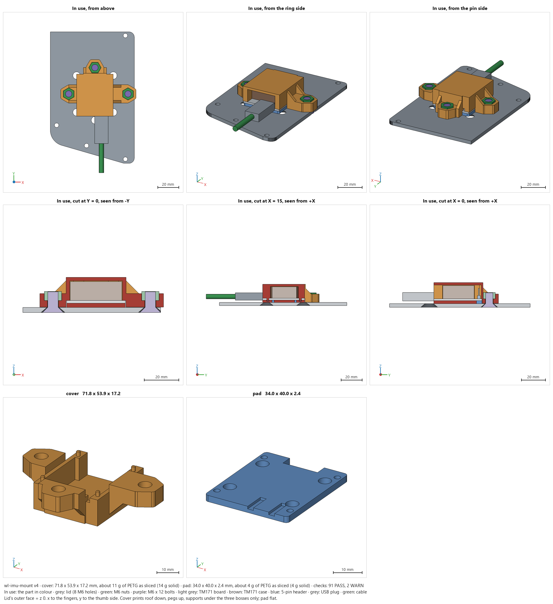
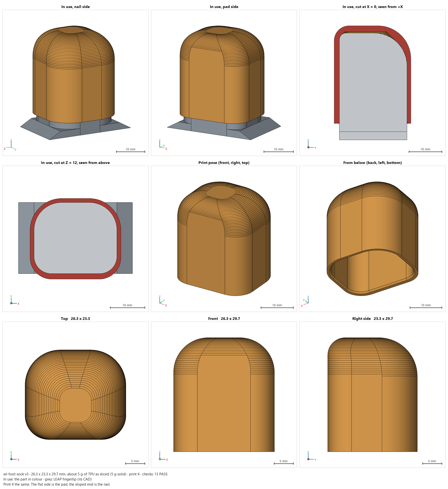

# Hardware: the parts printed for the hand

The latest version of each part, ready to slice. STL for printing, STEP to edit, a picture.
Millimetres. The simulator's copies of the same shapes are in `src/walking_leap/assets/parts/`.

## IMU mount (`imu_mount/`, v4)

Holds the SYD Dynamics TM171 IMU flat and tight on the back of the LEAP's palm, on the
lid's M6 holes: a **cover** over the board and a thin **pad** under it.

- **On the hand:** the board turned 90° (its pins towards the thumb side, its USB-C out
  by the ring side), centred on the lid's 35 mm bolt square. Three M6 flat-head bolts
  (12 or 16 mm) from inside the palm through the lid's top and two side holes, nuts in
  the cover's hex pockets. Four pegs go through the IMU's own M2 holes. Nothing covers the
  USB plug. In the code: `palm x = −IMU y, palm y = +IMU x, palm z = IMU z`.
- **v4** = v3 (printed, fits) plus room for a 5-pin header soldered on the board, pins up.
- **Print:** PETG, 0.20 mm layers, 4 walls, 15 % infill. Cover roof down, pegs up, tree
  supports on the build plate only (under the three bosses); pad flat, no supports.
  Print the pegs slowly. About 13 g (cover) and 4 g (pad).
- **Check before printing:** the board's long edges have 2 mm bare beside the case (the
  walls stand there).
- Licence: MIT (it only bolts to the hand, nothing is taken from LEAP's CAD).

## Foot sock (`foot_sock/`, v3)

A thin TPU skin over a stock LEAP fingertip, keeping its shape (flat pad, so the hand can
still grasp). Four of the same.

- 26.5 × 23.5 mm on the tip, 2.2 mm longer than it.
- **v3** = v2 (printed, a bit too tight) with half the squeeze (1 % instead of 2 %). Not
  printed yet.
- **Print:** TPU 95A, opening down, no supports, 0.16 mm layers, 3 walls, 100 % infill.
- In the simulator: `as_built=True` puts them on (about 4.8 g each, friction randomized).
  The real hand has run with stock fingertips so far.
- Licence: CC BY-SA 4.0 (it follows LEAP's fingertip): `foot_sock/LICENSE`.
